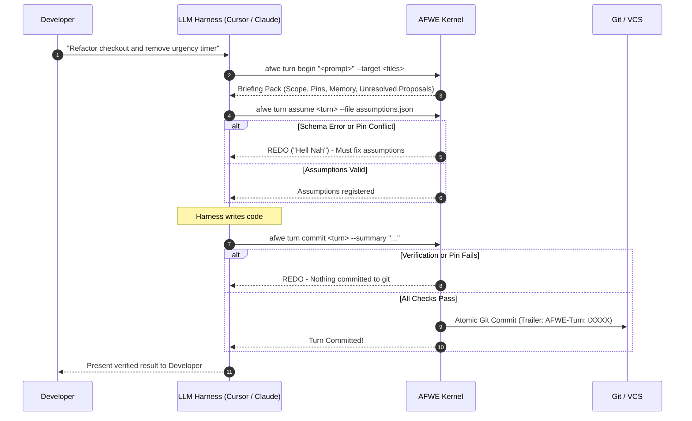

# AFWE Developer Tutorial: Zero to Mastery

Welcome to AFWE (**Architecture-First Workspace Engine**). This tutorial takes you step-by-step through configuring and using AFWE on any project, understanding how the turn protocol guarantees determinism with AI coding agents, and using guardrails, pins, and recovery mechanisms.

---

## 1. Core Philosophy: The Folder is the Product

AI coding agents (Claude Code, Cursor, Codex, OpenCode) rarely lose track of your code. They lose track of **why it is the way it is**.

Ask two agents for a narrow-body engine of 27,000 to 35,000 lbf and you get two good, different designs. One is a two-spool engine that is cheap to maintain. The other is a three-spool engine that burns less fuel and costs more to service. Neither is wrong. Fifteen prompts later a third agent sees code that works, cannot tell which trade-off you chose on purpose, and "improves" it.

That is the source of **silent collateral damage**:
- In Turn 1, the agent builds a billing integration.
- In Turn 15, the agent refactors a UI component and breaks the billing data contract.
- A feature disappears and nobody declared it.

Line drift and limited context windows make this worse, but the cause is that your intent was never recorded next to the code. Vendor-side memory does not fix it: it lives inside the vendor's product, not in your repository, so the next agent or the next teammate never receives it.

**AFWE keeps the intent in the repo**:
- It sits between your harness and the codebase.
- Your prompt, the agent's declared intents, your pins, memory and guardrails live in `.afwe/` as human-readable, git-friendly YAML and markdown.
- A deterministic gate refuses changes that break what you declared: constraints, block pins and undeclared feature loss. It stops the mistakes you have written down, not every mistake.
- **The verdict is always deterministic; LLMs propose**: AFWE never makes internal model calls. The harness or agent proposes intents and claims, while AFWE is the deterministic verification and judgment kernel. The agent writes claims that AFWE verifies with tree-sitter, AST parsing, and reproducible checks.
- **Unified Graph + Intent + Guardrails Loop**: Code knowledge graphing (the blueprint), intent memory (turns and living intents), and tripwires (active guardrails and materialized hooks) are not separate tools; they form a single continuous architectural feedback loop.

```text
Developer Prompt ──▶ Harness (Claude / Cursor) ──▶ AFWE Turn Protocol ──▶ Verified Git Commit
```

**What this costs, and where it stops**:
- Someone has to maintain a record of intent. The pin budget (section 4) is tied to project size, and the gate only checks what you declared.
- AFWE is not a harness and cannot force one to call it. The `AGENTS.md` contract is advisory. The hard stop is the generated `.github/workflows/afwe-gate.yml`, which runs `afwe gate` in CI. Without CI or a git hook, a harness that ignores the contract is not blocked.
- Harness-specific hook installers are not built yet. See `docs/INTEGRATION.md` for manual examples.

---

## 2. Onboarding: Initializing a Project

Setting up AFWE takes one command:

```bash
afwe onboard --profile engineer
```

What `afwe onboard` does automatically:
1. Detects your tech stack (Rust, TypeScript/Node, Python, Go, etc.).
2. Creates `.afwe/` with `afwe.yaml`, `blueprint/`, `memory/`, and `guardrails/`.
3. Scaffolds an initial structural blueprint tree from your folder layout.
4. Appends the non-negotiable contract block to `AGENTS.md` (and `CLAUDE.md`).
5. Configures your profile:
   - `normie`: Auto-commits turns when verification passes.
   - `engineer`: Stages passing turns for manual `git commit` review.

You can inspect your project status at any time:
```bash
afwe status
```

---

## 3. The Non-Negotiable Turn Protocol

Every prompt given to an AI agent is a **Turn**. The harness wraps every single coding request in 3 deterministic steps:



### Step 1: `afwe turn begin`
Before writing code, the harness calls `turn begin`:
```bash
afwe turn begin "<prompt>" --target <files> [--claim <files>] [--parent <turn>]
```
AFWE returns a **Briefing Pack** containing:
- In-scope architectural nodes and files.
- **Active Pins**: Human decisions locked against modification.
- **Memory & Rules**: Relevant architectural decisions, terminology, and constraints.
- **Unresolved Proposals**: Pending staged changes.
- **Turn Hash & Token**: An in-flight random hash (`turn-a8f3c2...`) and bearer token for isolated multi-agent concurrency.
- **Claims & Contention**: Declaring `--claim <files>` reserves files. If another active turn holds a claimed file, AFWE halts immediately with `CONTENTION` to prevent lost updates in the shared directory.

### Step 2: `afwe turn assume`
The harness declares what it intends to touch and its pre-generation claims:
```bash
afwe turn assume <turn> --file <json> [--token <tok>] [--claim <files>]
```
```json
{
  "intents": [
    {
      "id": "remove-timer",
      "action": "update",
      "targets": ["checkout"],
      "statement": "Remove countdown clock from checkout screen"
    }
  ],
  "assumptions": [
    {
      "id": "a1",
      "text": "Checkout contains no ticking-clock component",
      "claim": {
        "type": "forbid_pattern",
        "pattern": "ticking-clock",
        "files": ["src/checkout/**"]
      }
    }
  ]
}
```
If an assumption violates a locked Pin or has an invalid schema, AFWE returns **REDO** ("Hell Nah") and stops the harness before any code is generated.
- **Safe Redo**: Call `afwe turn redo <turn>` to cleanly reset touched files back to baseline. Affected files are automatically backed up to `.afwe/backups/<turn_hash>/`.
- **Abandon Turn**: Call `afwe turn abandon <turn>` to release all reserved claims and mark the turn abandoned.

### Step 3: `afwe turn commit`
After writing code, the harness calls `turn commit`:
```bash
afwe turn commit <turn> --summary "..." [--token <tok>]
```
AFWE executes the deterministic commit engine:
- **Virtual Index Overlay (Dirty Workspace Immunity)**: In multi-agent sessions, static analysis evaluates claimed files from disk while streaming out-of-scope files directly from Git HEAD in memory. In-progress typing from peer agents cannot poison the commit gate.
- **Parser & Constraint Checks**: Verifies AST boundaries (`forbid_import`, `require_pattern`).
- **Assumption Verification**: Evaluates all claims declared in `turn assume`.
- **Intra-file Dropped Capabilities (`DROPPED_CAPABILITY`)**: Detects exported functions/types dropped from touched files.
- **Cross-module Inbound Reference Ratchet (`SEVERED_CAPABILITY`)**: Scans inbound caller deltas workspace-wide. If an agent removes a call in one file leaving a function dead with 0 callers in an untouched file, the gate blocks with `SEVERED_CAPABILITY`.
- **Dead-on-Arrival Detection (`DEAD_ON_ARRIVAL`)**: Flags new exported functions born with 0 callers unless tested in `tests/` or declared in `turn assume`.
- **Decision-to-Code Link Ratchet (`ORPHANED_DECISION` / `ORPHANED_PIN`)**: Blocks if an architectural decision or pin loses its anchored node, file, or symbol without an explicit update or supersede declaration.
- **Documentation Drift (`DOCS_DRIFT`)**: Blocks if doc files contain broken links to missing project code.
- **Private Plumbing Commit**: Commits are written via private Git index trees (`GIT_INDEX_FILE`), verified via CAS (`git update-ref`), and protected by an OS advisory commit lock (`flock`/`LockFileEx`). Only attributed files are committed—peer agents' dirty files are never swept in.

- If any check fails: **REDO** — nothing is committed to git.
- If all checks pass: The change is committed with trailer `AFWE-Turn: tXXXX` and `AFWE-Turn-Hash: turn-XXXX`.

> [!NOTE]
> **"Rust for Project Intent"**:
> Rust made memory mistakes impossible to make quietly, and AFWE makes regressions of intent impossible to make quietly. *"Quietly"* is the word that keeps the claim honest: you can still break things on purpose, but you can never break them by accident.

> [!IMPORTANT]
> **Over-Approximation Policy (Safe Error Direction)**:
> To prevent false alarms on dynamic dispatch, macros, or string lookups, the identifier index over-approximates references. Any identifier token occurrence in code counts as a reference.
> - **The Guarantee**: AFWE will never falsely block live code.
> - **The Trade-off**: Generic names (`new`, `len`, `init`, `run`, `default`, `get`, `set`) are intentionally treated as always referenced and unflaggable.
> - **Language-Adaptive**: Weakly typed languages (Python/JS) leverage identifier token matching across files; typed languages (Rust/Go/TS) leverage module-scoped import specifiers where available.

---

## 4. Protecting Decisions with Pins

Pins are human-locked invariants that agents cannot override without explicit permission.

### Creating a Pin
```bash
# Lock a critical invariant
afwe pin add "Payments must never call UI or frontend components" --node payments --severity block

# Propose an intentional marker (e.g. intentional temporary behavior)
afwe pin add "Allow mock token in dev environment" --node auth --severity confirm --intentional
```

### Pin Budgets
To prevent pin sprawl, AFWE calculates a budget derived from your codebase size:
```bash
afwe pin budget --slider 3
```
- Slider 1: Relaxed (fewer pins enforced).
- Slider 3: Balanced.
- Slider 5: Strict.

If an agent attempts to touch a pinned invariant, the gate triggers a **REDO**:
```text
REDO — t0004 NOT committed
  ✖ PIN_CONFLICT: pin pin-5babbe protects node afwe-core
```
To proceed, the agent must provide an explicit `--override pin-id="reason"` justification.

---

## 5. Guardrails: What You Control vs What the Agent Controls

| Guardrail Type | Who Controls It | How It Works |
| --- | --- | --- |
| **Passive Guardrails** (`.afwe/guardrails/passive/*.yaml`) | **Human** | Rendered into context whenever an agent touches matching files or nodes. Example: *"Widgets must work behind corporate proxies."* |
| **Active Guardrails** (`.afwe/guardrails/active/*.yaml`) | **Human & CI** | Executed deterministically on `afwe verify` and `turn commit`. Enforces AST rules: `forbid_import`, `forbid_pattern`, `require_pattern`, `require_file`, `command`. |
| **Living Intents** (`.afwe/intents/*.yaml`) | **Agent-First** | Created and updated by the harness on each turn. Captures the living DAG of features being designed and implemented. |
| **Memory** (`.afwe/memory/decisions/*.md`) | **Human & Agent** | Persisted architectural decisions, exceptions, and terminology. |

---

## 6. Building for the Future: Planned Architecture

You can plan architectural evolutions without failing current builds:

```bash
# Add a planned node
afwe blueprint add "billing-v2" --parent payments --status planned

# Add a forward-looking constraint
afwe blueprint constrain billing-v2 --must-not-depend legacy-db --planned --why "Decouple from legacy schema"
```

- **Exempt from False Drift**: Planned nodes never trigger missing-file drift warnings.
- **Non-blocking Warnings**: Planned constraints are displayed as `[PLANNED DIRECTION: non-blocking]` in context briefings, giving agents context on where the architecture is heading without blocking pre-commit gates.

---

## 7. Recovery & Timeline: 3-Way Feature Restoration

Every committed turn is indexed by intent. You can view project history at any time:
```bash
afwe timeline
```

```text
history via git · 3 turn(s)
t0003   committed  1a8af03  deterministic 100%  docs: document futures engine...
t0002   committed  a6efb21  deterministic 100%  feat: support architectural directions...
t0001   committed  f65ea39  deterministic 100%  add multi-intent-funnel stress test...
```

### Restoring a Feature Lost by an Agent
If prompt 14 accidentally stripped a feature added in prompt 3:
```bash
# Preview what would be restored
afwe timeline restore my-feature

# Apply 3-way merge restoration
afwe timeline restore my-feature --apply
```
AFWE executes a true 3-way merge against the last good commit, opens a new turn, and stages the restoration cleanly.

---

## 8. Inferred Intent, Probing Guides & Calibration

AFWE infers intent from prompts, code diffs, and AST symbol changes. To avoid the echo-chamber graduation trap, inferred rules undergo rigorous verification before becoming hard guardrails:

- **Probing Guides (0.85 – 0.90 confidence)**:
  Injected into context briefings as advisory guides (`[GUIDE - ADVISORY]`). They guide the agent without blocking commits.
- **Evidence Rubric & Hold-Out Probes**:
  A guide does not graduate simply because an obedient agent followed it. It requires:
  - $\ge 3$ qualifying turns touching the target scope across distinct user sessions.
  - At least 1 hold-out probe turn where the guide was deliberately withheld from context and the agent still preserved the invariant.
  - 0 contradictions and a model calibration trust factor $\ge 0.8$.
- **Graduation Policy**:
  - **Option A (Default, `policy.graduation.require_human = true`)**: Once evidence criteria are met, the guide moves to `ready_to_graduate`. One explicit human confirmation (`afwe guide confirm <id>`) promotes it to an active blocking check.
  - **Option B (`policy.graduation.require_human = false`)**: Auto-graduates when criteria are met.
- **Ambiguity Queue (< 0.85 confidence)**:
  High-blast-radius ambiguities (nodes with $\ge 2$ dependents or touching shared interfaces) generate questions (`afwe question list`, `afwe question answer <id> <text>`), capped at 3 open questions per session.

---

## 9. Tripwires & Preview-First Materialization

Tripwires enforce architectural boundaries in local Git hooks and CI:

```bash
# Preview proposed tripwire files and git hooks
afwe materialize

# Apply tripwires (creates BLAKE3 manifest, chains git pre-commit hooks, CI workflow)
afwe materialize --apply

# Verify tripwires in CI against base branch
afwe materialize --check --base origin/main

# Cleanly remove all materialized tripwires and restore git hooks
afwe materialize --remove
```

The CI workflow verifies that PRs do not tamper with guardrails by checking against the protected base branch manifest.

---

## 10. Explore Mode & Stats Telemetry

For early-stage prototyping or spike tasks:
```bash
# Temporarily relax blocking gates
afwe unlock --reason "Spike on checkout architecture"

# Re-arm deterministic blocking gates
afwe lock
```

Inspect gate metrics, parse times, and calibration telemetry:
```bash
afwe stats
```

