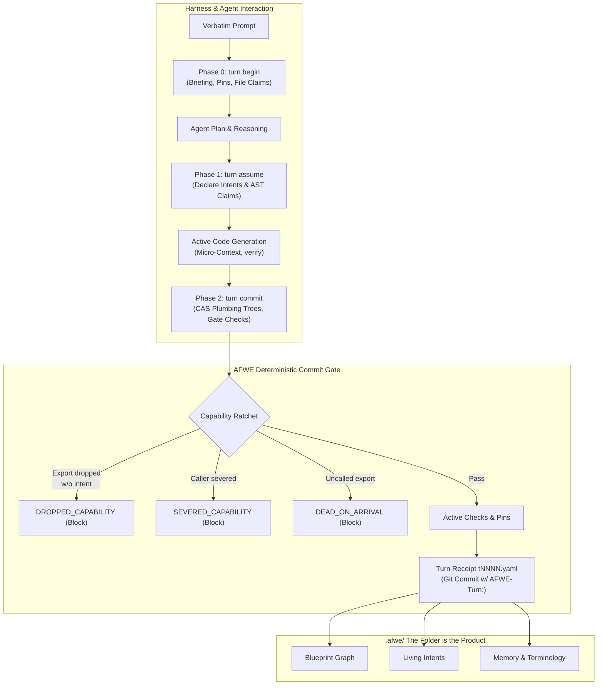

# AFWE Ubiquitous Language Dictionary

> **Canonical Domain Glossary & Semantic Model for AFWE-Core & AFWE-Client**
>
> In Domain-Driven Design (DDD), the **Ubiquitous Language** provides an unambiguous, shared vocabulary between software architects, human developers, agent harnesses, tools, and code. All agents MUST consult and preserve this language across plans, intents, code generation, and pull requests.

## Domain Model & Architectural Lifecycle

## Quick Reference Table

| Term | Category | Meaning Summary | Not To Be Confused With |
| :--- | :--- | :--- | :--- |
| [**Ambiguity Question**](#ambiguity-question) | Confidence Bands & Calibration | A high-blast-radius architectural dilemma generated when system confidence falls below 85% (`afwe question list`). Instead of making an unverified guess, AFWE pauses and queues the question for human architect confirmation, persisting the resolution into memory or pins. | Probing Guide |
| [**Blueprint**](#blueprint) | Blueprint & Cartography | The deterministic hierarchical architecture tree defining the product's structure, declared across `afwe.yaml` and `.afwe/blueprint/` (`blueprint.yaml`, `relations.yaml`, `constraints.yaml`). It maps code files and symbols to architectural nodes, defines permitted relationships, and sets boundaries. | Index |
| [**Blueprint Node**](#blueprint-node) | Blueprint & Cartography | An architectural entity within the Blueprint tree representing a product, subsystem, module, or component. Each node has an ID, human-readable name, purpose statement, implementation mapping (file globs and symbols), status (`active`, `planned`, `deprecated`, `uncharted`), and architectural boundaries. | File / Directory |
| [**Capability Ratchet**](#capability-ratchet) | Ratchets & Integrity Verification | A monotonic architectural safety mechanism enforced during `afwe turn commit`. It guarantees that codebase capabilities, public API exports, caller references, decisions, and documentation references can only advance or remain stable—never unintentionally degrade. Intentionally breaking a capability requires an explicit declaration in `turn assume`. | Unit Testing |
| [**Check**](#check) | Ratchets & Integrity Verification | An executable verification item registered in `.afwe/checks/*.yaml` evaluated during `afwe verify` and `afwe turn commit`. Checks possess trust ratings, explicit authorship (human, generator, agent), and deterministic pass/fail semantics. | Claim |
| [**Claim**](#claim) | Claims & Tripwires | A pre-generation assertion declared during Phase 1 (`afwe turn assume`) before code is written. Claims include: | Intent |
| [**Concurrency Lease**](#concurrency-lease) | Multi-Agent Concurrency & Worktrees | A mutual exclusion mechanism (`afwe lease acquire <node>`) that grants temporary exclusive write permissions on specific Blueprint nodes and their mapped files to an agent or worktree, preventing concurrent agents from generating conflicting changes. | File Claim |
| [**Contention**](#contention) | Multi-Agent Concurrency & Worktrees | A concurrency conflict state returned when an agent attempts to begin a turn or acquire claims/leases on files or blueprint nodes already held by another active agent session. When contention occurs, the agent must defer, release overlapping claims, or coordinate via mission boundaries rather than overwriting concurrently. | Merge Conflict |
| [**Context Codename Separation**](#context-codename-separation) | Architecture Philosophy & Tenets | The strict architectural separation governing AFWE development between two distinct contexts: | Client/Server Networking |
| [**DEAD_ON_ARRIVAL**](#dead_on_arrival) | Ratchets & Integrity Verification | A blocking commit gate error triggered when a newly introduced exported function or capability is born with 0 callers and no tests exercising it, without an explicit intent declaration. | DROPPED_CAPABILITY |
| [**DOCS_DRIFT**](#docs_drift) | Ratchets & Integrity Verification | A commit gate error triggered when markdown documentation files (`README.md`, `docs/*.md`, `.afwe/docs/*.md`) contain broken links to code files, outdated symbol paths, or deleted source files. | Drift |
| [**Drift**](#drift) | Blueprint & Cartography | Any disagreement between the physical codebase (analyzed files, AST imports, symbol definitions) and the Blueprint tree. Detected via `afwe drift` or during `afwe sync`. Disagreements are triaged by confidence: | Constraint Violation |
| [**DROPPED_CAPABILITY**](#dropped_capability) | Ratchets & Integrity Verification | A blocking commit gate error triggered when an intra-file public export or capability is deleted or privatized without an explicit removal or replacement declared in `turn assume` (`removes: [...]` or `action: remove / replace`). | SEVERED_CAPABILITY |
| [**Explore Mode**](#explore-mode) | Confidence Bands & Calibration | A temporary mode activated via `afwe unlock --reason "..."` that downgrades blocking active checks and capability ratchets into non-blocking warnings during active exploratory refactoring or rapid prototyping. The harness must re-arm the gate before release via `afwe lock`, which triggers full architecture verification. | Bypassing the Gate |
| [**Guardrail**](#guardrail) | Architecture Philosophy & Tenets | An architectural constraint divided into two complementary forms: | Pin, Check |
| [**Intent**](#intent) | Memory, Pins & Living Intents | A living, persistent statement of architectural purpose and desired behavior stored in `.afwe/intents/*.yaml`. Derived and merged from verbatim user prompts over time, intents capture what the codebase is intended to do, its historical evolution, and its implementation mappings. | Turn, Workflow |
| [**Materializer**](#materializer) | Claims & Tripwires | The engine component invoked via `afwe materialize` (or MCP `afwe_materialize`) that renders AFWE tripwires into native workspace files (`.git/hooks/pre-commit`, `.github/workflows/afwe-gate.yml`, native test suites, `AGENTS.md` markers, and `.afwe/checks/manifest.blake3`). It offers preview-first application (`--dry-run` by default) and rollback capabilities. | afwe init |
| [**Micro-Context**](#micro-context) | Blueprint & Cartography | The targeted, highly scoped architectural context retrieved via `afwe context <files>` (or MCP tool `afwe_context`). Before an agent touches a file, micro-context delivers only the nodes, purpose statements, decisions, exceptions, constraints, ubiquitous terminology, and active guardrails that directly apply to those specific files. | Whole-Repository Prompting |
| [**Mission**](#mission) | Multi-Agent Concurrency & Worktrees | A goal-oriented coordination structure stored in `.afwe/missions/*.yaml` that orchestrates multiple autonomous agents across isolated Git worktrees. Missions break complex epics into discrete turn obligations, managing concurrency leases, shared node boundaries, and merge gates. | Turn |
| [**ORPHANED_DECISION**](#orphaned_decision) | Ratchets & Integrity Verification | A commit gate error triggered when an architectural decision record in `.afwe/memory/decisions/` is anchored to files or symbols that have been deleted or moved without updating or superseding the decision. | ORPHANED_PIN |
| [**ORPHANED_PIN**](#orphaned_pin) | Ratchets & Integrity Verification | A commit gate error triggered when a human-locked pin in `.afwe/pins/` targets architectural nodes, files, or symbols that no longer exist in the working tree. Pins require explicit human override or retirement. | ORPHANED_DECISION |
| [**Phase 0 (Briefing & Pins)**](#phase-0-briefing-pins) | Turn Protocol & Lifecycle | The initial pre-planning phase of a turn initiated via `afwe turn begin "<prompt>" --target <files> [--claim <files>]`. It stores the prompt verbatim, generates a deterministic briefing pack including active pins, guardrails, memory, active intents, and probing guides, issues a bearer security token, and acquires upfront file claims to prevent multi-agent contention. | Phase 1 (turn assume) |
| [**Phase 1 (Pre-Code Declaration)**](#phase-1-pre-code-declaration) | Turn Protocol & Lifecycle | The pre-code declaration phase invoked via `afwe turn assume <turn> --file <json> [--token <tok>]`. Before any code is generated or edited, the agent explicitly registers its architectural intents, file claims, and pre-generation AST assertions (`forbid_import`, `forbid_symbol`, `export_exists`, `symbol_signature`, `pattern`, `command`). Intentional removals must be declared in `removes` to satisfy the strict "Rust for project intent" compiler model. | Phase 2 (turn commit) |
| [**Phase 2 (Gated Commit)**](#phase-2-gated-commit) | Turn Protocol & Lifecycle | The final gated commit phase invoked via `afwe turn commit <turn> --summary "..." [--token <tok>]`. AFWE isolates working changes via Git plumbing trees with Content-Addressable Storage (CAS) verification and advisory OS commit locks, executing the gate against active pins, claims, and capability ratchets before recording the turn in `.afwe/turns/` and emitting an `AFWE-Turn:` trailer. | git commit -m |
| [**Pin**](#pin) | Memory, Pins & Living Intents | A human-locked architectural decision or intentional bug stored in `.afwe/pins/*.yaml`. Pins represent immutable boundaries that automated agents and refactorings are strictly forbidden from breaking or deleting without an explicit override `{pin, reason}`. Pins are capped under a codebase-scaled budget to prevent architectural ossification. | Guardrail, Decision (Memory) |
| [**Probing Guide**](#probing-guide) | Confidence Bands & Calibration | An advisory architectural hint emitted in Phase 0 briefings with 85%–90% confidence (`[GUIDE - ADVISORY]`). Probing guides steer the agent toward emerging architectural patterns without hard-blocking execution. When repeatedly adhered to, probing guides graduate into active deterministic checks via `afwe guide graduate`. | Active Check, Ambiguity Question |
| [**Ratchet Baseline**](#ratchet-baseline) | Ratchets & Integrity Verification | A snapshot mechanism (`afwe baseline snapshot`) used when onboarding legacy codebases to grandfather pre-existing violations, uncalled exports, or circular imports without failing the gate. The gate prevents any *new* regressions from being introduced beyond the recorded baseline. | Ratchet |
| [**Rust for Project Intent**](#rust-for-project-intent) | Architecture Philosophy & Tenets | The foundational design philosophy of AFWE: applying the unforgiving, deterministic mental model of the Rust compiler to overall project architecture and intent. Under this paradigm, you can break things on purpose by declaring them explicitly in `turn assume` (`removes: [...]`), but the gate ensures you can never break things by accident. | Programming Language Choice |
| [**SEVERED_CAPABILITY**](#severed_capability) | Ratchets & Integrity Verification | A blocking commit gate error triggered when cross-module caller severance drops inbound references to an exported function or struct from >0 to 0, turning previously consumed functionality into dead code without declared intent. | DEAD_ON_ARRIVAL |
| [**The Folder is the Product**](#the-folder-is-the-product) | Architecture Philosophy & Tenets | The core tenet of AFWE stating that `.afwe/` itself is the persistent, tool-agnostic structural model of the project. The engine that reads and writes it (CLI, MCP, Studio) is completely replaceable; the folder, its yaml files, markdown memory, and git history remain the durable single source of architectural truth. | Ephemeral Cache or Lockfile |
| [**Tripwire**](#tripwire) | Claims & Tripwires | A deterministic, preview-first defensive layer materialized directly into developer and CI harnesses (git hooks, GitHub Actions CI gates, native unit test harnesses, AGENTS.md blocks, and BLAKE3 manifests). Tripwires intercept architectural regressions outside of AFWE commands. | Passive Guardrail |
| [**Turn**](#turn) | Turn Protocol & Lifecycle | A discrete, atomic engineering lifecycle unit spanning exactly one prompt ("one prompt = one turn"). A turn progresses sequentially through three deterministic phases: Phase 0 (`afwe turn begin`) pre-planning briefing, Phase 1 (`afwe turn assume`) pre-code intent and claims declaration, and Phase 2 (`afwe turn commit`) post-verification gated commit via isolated Git plumbing trees with CAS verification. | Intent, Git Commit |
| [**Turn Abandon**](#turn-abandon) | Turn Protocol & Lifecycle | A turn cancellation command (`afwe turn abandon <turn>`) that discards an open uncommitted turn, immediately releasing all file claims, locks, and temporary token reservations without altering the Git tree. | Turn Redo |
| [**Turn Receipt**](#turn-receipt) | Turn Protocol & Lifecycle | The immutable record produced upon turn commit, saved in `.afwe/turns/tNNNN.yaml`. It contains the original prompt verbatim, origin, timing, gate evaluation, intent updates, files modified, checks executed, capability ratchets checked, and Git commit hash. | Intent |
| [**Turn Redo**](#turn-redo) | Turn Protocol & Lifecycle | A safety command (`afwe turn redo <turn>`) that cleanly reverts uncommitted workspace edits back to the turn's begin baseline (backed up in `.afwe/backups/<turn_hash>/`), while keeping the turn open and retaining locks for rework. | Turn Abandon, Turn Undo / Revert |

## Detailed Vocabulary by Category

### Confidence Bands & Calibration

#### Ambiguity Question 

- **ID**: `term-ambiguity-question`
- **Tags**: `confidence-bands`, `human-in-the-loop`
- **Applies to**: `afwe-core`, `afwe-cli`

**Meaning:**
A high-blast-radius architectural dilemma generated when system confidence falls below 85% (`afwe question list`). Instead of making an unverified guess, AFWE pauses and queues the question for human architect confirmation, persisting the resolution into memory or pins.

**Not to be confused with:**
- **Probing Guide**: Probing guides (85%–90%) advise agents without blocking; Ambiguity Questions (<85%) halt high-risk forks for human judgment.

---

#### Explore Mode 

- **ID**: `term-explore-mode`
- **Tags**: `explore-mode`, `prototyping`
- **Applies to**: `afwe-core`, `afwe-cli`

**Meaning:**
A temporary mode activated via `afwe unlock --reason "..."` that downgrades blocking active checks and capability ratchets into non-blocking warnings during active exploratory refactoring or rapid prototyping. The harness must re-arm the gate before release via `afwe lock`, which triggers full architecture verification.

**Not to be confused with:**
- **Bypassing the Gate**: Explore Mode does not disable detection; it downgrades errors to warnings temporarily while recording the explicit reason in the log.

---

#### Probing Guide 

- **ID**: `term-probing-guide`
- **Tags**: `confidence-bands`, `advisory`
- **Applies to**: `afwe-core`, `afwe-cli`

**Meaning:**
An advisory architectural hint emitted in Phase 0 briefings with 85%–90% confidence (`[GUIDE - ADVISORY]`). Probing guides steer the agent toward emerging architectural patterns without hard-blocking execution. When repeatedly adhered to, probing guides graduate into active deterministic checks via `afwe guide graduate`.

**Not to be confused with:**
- **Active Check**: Active checks block the commit gate; Probing Guides are non-blocking advisory steering.
- **Ambiguity Question**: Questions have <85% confidence and require human decision; Probing Guides have 85%–90% confidence and steer agents automatically.

---

### Blueprint & Cartography

#### Blueprint 

- **ID**: `term-blueprint`
- **Tags**: `blueprint`, `architecture-tree`
- **Applies to**: `afwe-core`, `afwe-cli`

**Meaning:**
The deterministic hierarchical architecture tree defining the product's structure, declared across `afwe.yaml` and `.afwe/blueprint/` (`blueprint.yaml`, `relations.yaml`, `constraints.yaml`). It maps code files and symbols to architectural nodes, defines permitted relationships, and sets boundaries.

**Not to be confused with:**
- **Index**: The index is derived AST metadata generated from code files; the Blueprint is the authoritative structural reality that code is measured against.

---

#### Blueprint Node 

- **ID**: `term-blueprint-node`
- **Tags**: `blueprint`, `topology`
- **Applies to**: `afwe-core`, `afwe-cli`

**Meaning:**
An architectural entity within the Blueprint tree representing a product, subsystem, module, or component. Each node has an ID, human-readable name, purpose statement, implementation mapping (file globs and symbols), status (`active`, `planned`, `deprecated`, `uncharted`), and architectural boundaries.

**Not to be confused with:**
- **File / Directory**: A node is a logical concept. While it maps to files, multiple files can form one module node, or a single file can contain multiple component symbols.

---

#### Drift 

- **ID**: `term-drift`
- **Tags**: `drift`, `reconciliation`
- **Applies to**: `afwe-core`, `afwe-cli`

**Meaning:**
Any disagreement between the physical codebase (analyzed files, AST imports, symbol definitions) and the Blueprint tree. Detected via `afwe drift` or during `afwe sync`. Disagreements are triaged by confidence:
- Confidence >= 90%: auto-reconciled.
- Confidence 50%–90%: presented as soft changes.
- Confidence < 50% or structural changes: staged as proposals awaiting human confirmation.

**Not to be confused with:**
- **Constraint Violation**: A constraint violation is an active rule failure (e.g., forbidden import); Drift is an unmapped or shifted structural divergence between code and blueprint.

---

#### Micro-Context 

- **ID**: `term-micro-context`
- **Tags**: `context`, `passive-guardrails`
- **Applies to**: `afwe-core`, `afwe-cli`

**Meaning:**
The targeted, highly scoped architectural context retrieved via `afwe context <files>` (or MCP tool `afwe_context`). Before an agent touches a file, micro-context delivers only the nodes, purpose statements, decisions, exceptions, constraints, ubiquitous terminology, and active guardrails that directly apply to those specific files.

**Not to be confused with:**
- **Whole-Repository Prompting**: Micro-context specifically avoids dumping the entire codebase or full architecture into the LLM context, keeping token usage low and focus razor-sharp.

---

### Ratchets & Integrity Verification

#### Capability Ratchet 

- **ID**: `term-capability-ratchet`
- **Tags**: `ratchet`, `verification`, `gate`
- **Applies to**: `afwe-core`, `afwe-cli`

**Meaning:**
A monotonic architectural safety mechanism enforced during `afwe turn commit`. It guarantees that codebase capabilities, public API exports, caller references, decisions, and documentation references can only advance or remain stable—never unintentionally degrade. Intentionally breaking a capability requires an explicit declaration in `turn assume`.

**Not to be confused with:**
- **Unit Testing**: Unit tests check functional runtime correctness; Capability Ratchets check static architectural reachability, export continuity, and reference graphs.

---

#### Check 

- **ID**: `term-check`
- **Tags**: `checks`, `gate`
- **Applies to**: `afwe-core`, `afwe-cli`

**Meaning:**
An executable verification item registered in `.afwe/checks/*.yaml` evaluated during `afwe verify` and `afwe turn commit`. Checks possess trust ratings, explicit authorship (human, generator, agent), and deterministic pass/fail semantics.

**Not to be confused with:**
- **Claim**: A Claim is an assertion declared during `turn assume`; once registered or graduated, it becomes an enforced Check in the registry.

---

#### DEAD_ON_ARRIVAL 

- **ID**: `term-dead-on-arrival`
- **Tags**: `ratchet`, `gate-error`
- **Applies to**: `afwe-core`, `afwe-cli`

**Meaning:**
A blocking commit gate error triggered when a newly introduced exported function or capability is born with 0 callers and no tests exercising it, without an explicit intent declaration.

**Not to be confused with:**
- **DROPPED_CAPABILITY**: DROPPED_CAPABILITY is an export that was deleted; DEAD_ON_ARRIVAL is a new export that was created but left orphaned and unused.

---

#### DOCS_DRIFT 

- **ID**: `term-docs-drift`
- **Tags**: `ratchet`, `documentation`, `gate-error`
- **Applies to**: `afwe-core`, `afwe-cli`

**Meaning:**
A commit gate error triggered when markdown documentation files (`README.md`, `docs/*.md`, `.afwe/docs/*.md`) contain broken links to code files, outdated symbol paths, or deleted source files.

**Not to be confused with:**
- **Drift**: Blueprint drift is code-to-blueprint divergence; DOCS_DRIFT is documentation-to-code divergence.

---

#### DROPPED_CAPABILITY 

- **ID**: `term-dropped-capability`
- **Tags**: `ratchet`, `gate-error`
- **Applies to**: `afwe-core`, `afwe-cli`

**Meaning:**
A blocking commit gate error triggered when an intra-file public export or capability is deleted or privatized without an explicit removal or replacement declared in `turn assume` (`removes: [...]` or `action: remove / replace`).

**Not to be confused with:**
- **SEVERED_CAPABILITY**: DROPPED_CAPABILITY occurs when the public export itself disappears; SEVERED_CAPABILITY occurs when external callers are disconnected.

---

#### ORPHANED_DECISION 

- **ID**: `term-orphaned-decision`
- **Tags**: `ratchet`, `memory`, `gate-error`
- **Applies to**: `afwe-core`, `afwe-cli`

**Meaning:**
A commit gate error triggered when an architectural decision record in `.afwe/memory/decisions/` is anchored to files or symbols that have been deleted or moved without updating or superseding the decision.

**Not to be confused with:**
- **ORPHANED_PIN**: ORPHANED_DECISION applies to ADR memory; ORPHANED_PIN applies to human-locked pins in `.afwe/pins/`.

---

#### ORPHANED_PIN 

- **ID**: `term-orphaned-pin`
- **Tags**: `ratchet`, `pins`, `gate-error`
- **Applies to**: `afwe-core`, `afwe-cli`

**Meaning:**
A commit gate error triggered when a human-locked pin in `.afwe/pins/` targets architectural nodes, files, or symbols that no longer exist in the working tree. Pins require explicit human override or retirement.

**Not to be confused with:**
- **ORPHANED_DECISION**: ORPHANED_PIN involves human-locked invariant pins; ORPHANED_DECISION involves persistent ADR memory records.

---

#### Ratchet Baseline 

- **ID**: `term-baseline`
- **Tags**: `ratchet`, `baseline`
- **Applies to**: `afwe-core`, `afwe-cli`

**Meaning:**
A snapshot mechanism (`afwe baseline snapshot`) used when onboarding legacy codebases to grandfather pre-existing violations, uncalled exports, or circular imports without failing the gate. The gate prevents any *new* regressions from being introduced beyond the recorded baseline.

**Not to be confused with:**
- **Ratchet**: The ratchet is the monotonic enforcement rule; the baseline is the grandfathered zero-point snapshot.

---

#### SEVERED_CAPABILITY 

- **ID**: `term-severed-capability`
- **Tags**: `ratchet`, `gate-error`
- **Applies to**: `afwe-core`, `afwe-cli`

**Meaning:**
A blocking commit gate error triggered when cross-module caller severance drops inbound references to an exported function or struct from >0 to 0, turning previously consumed functionality into dead code without declared intent.

**Not to be confused with:**
- **DEAD_ON_ARRIVAL**: SEVERED_CAPABILITY affects previously used code that lost its callers; DEAD_ON_ARRIVAL affects newly introduced code that was never called.

---

### Claims & Tripwires

#### Claim 

- **ID**: `term-claim`
- **Tags**: `claims`, `pre-generation`
- **Applies to**: `afwe-core`, `afwe-cli`

**Meaning:**
A pre-generation assertion declared during Phase 1 (`afwe turn assume`) before code is written. Claims include:
- `forbid_import`: prevents illegal cross-node imports.
- `forbid_symbol`: disallows blacklisted symbols or deprecated constructs.
- `export_exists`: guarantees expected public functions or types remain exposed.
- `symbol_signature`: verifies parameter and return types match contract specifications.
- `pattern`: applies regex checks with automatic comment blanking.
- `command`: executes a shell test command.
- File Claims: locks specific files to avoid concurrent edit collisions.

**Not to be confused with:**
- **Intent**: Intent states what behavior is desired; a Claim states concrete structural boundaries that code must satisfy.

---

#### Materializer 

- **ID**: `term-materializer`
- **Tags**: `materializer`, `tripwire`
- **Applies to**: `afwe-core`, `afwe-cli`

**Meaning:**
The engine component invoked via `afwe materialize` (or MCP `afwe_materialize`) that renders AFWE tripwires into native workspace files (`.git/hooks/pre-commit`, `.github/workflows/afwe-gate.yml`, native test suites, `AGENTS.md` markers, and `.afwe/checks/manifest.blake3`). It offers preview-first application (`--dry-run` by default) and rollback capabilities.

**Not to be confused with:**
- **afwe init**: `init` scaffolds `.afwe/`; `materialize` projects active tripwire enforcement into external files outside `.afwe/`.

---

#### Tripwire 

- **ID**: `term-tripwire`
- **Tags**: `tripwire`, `materializer`
- **Applies to**: `afwe-core`, `afwe-cli`

**Meaning:**
A deterministic, preview-first defensive layer materialized directly into developer and CI harnesses (git hooks, GitHub Actions CI gates, native unit test harnesses, AGENTS.md blocks, and BLAKE3 manifests). Tripwires intercept architectural regressions outside of AFWE commands.

**Not to be confused with:**
- **Passive Guardrail**: Passive guardrails advise the agent during context loading; Tripwires hard-block git commits, pushes, and CI builds if invariants fail.

---

### Multi-Agent Concurrency & Worktrees

#### Concurrency Lease 

- **ID**: `term-lease`
- **Tags**: `multi-agent`, `concurrency`
- **Applies to**: `afwe-core`, `afwe-cli`

**Meaning:**
A mutual exclusion mechanism (`afwe lease acquire <node>`) that grants temporary exclusive write permissions on specific Blueprint nodes and their mapped files to an agent or worktree, preventing concurrent agents from generating conflicting changes.

**Not to be confused with:**
- **File Claim**: A File Claim operates at the individual file path level during a turn; a Concurrency Lease operates at the architectural node level across multiple worktrees and missions.

---

#### Contention 

- **ID**: `term-contention`
- **Tags**: `multi-agent`, `concurrency`
- **Applies to**: `afwe-core`, `afwe-cli`

**Meaning:**
A concurrency conflict state returned when an agent attempts to begin a turn or acquire claims/leases on files or blueprint nodes already held by another active agent session. When contention occurs, the agent must defer, release overlapping claims, or coordinate via mission boundaries rather than overwriting concurrently.

**Not to be confused with:**
- **Merge Conflict**: Git merge conflict occurs after text has diverged; Contention is preemptively prevented before code generation starts.

---

#### Mission 

- **ID**: `term-mission`
- **Tags**: `multi-agent`, `coordination`
- **Applies to**: `afwe-core`, `afwe-cli`

**Meaning:**
A goal-oriented coordination structure stored in `.afwe/missions/*.yaml` that orchestrates multiple autonomous agents across isolated Git worktrees. Missions break complex epics into discrete turn obligations, managing concurrency leases, shared node boundaries, and merge gates.

**Not to be confused with:**
- **Turn**: A Turn is executed by a single agent for a single prompt; a Mission coordinates multiple agents and turns toward a composite outcome.

---

### Architecture Philosophy & Tenets

#### Context Codename Separation 

- **ID**: `term-context-separation`
- **Tags**: `architecture-philosophy`, `repository-rules`
- **Applies to**: `afwe-core`, `afwe-cli`

**Meaning:**
The strict architectural separation governing AFWE development between two distinct contexts:
1. **AFWE-Core**: This engine repository, its Rust crates (`afwe-core`, `afwe-cli`), binaries, MCP server, Studio, and master documentation in `docs/` and `crates/`.
2. **AFWE-Client**: Consumer codebases initialized with `afwe init` or `afwe onboard`, whose scaffolds and templates live inside `.afwe/`. Client docs and generator templates must always reference `.afwe/docs/TUTORIAL.md`, never root `docs/`.

**Not to be confused with:**
- **Client/Server Networking**: This is not a network protocol; it is an architectural contract distinguishing engine authoring from client consumer scaffolding.

---

#### Guardrail 

- **ID**: `term-guardrail`
- **Tags**: `guardrails`, `verification`
- **Applies to**: `afwe-core`, `afwe-cli`

**Meaning:**
An architectural constraint divided into two complementary forms:
1. **Passive Guardrail**: Targeted contextual instructions injected into the agent's micro-context (`afwe context <files>`) before editing begins.
2. **Active Guardrail**: Concrete test, AST inspection, or claim enforced by `afwe verify` and the commit gate.

**Not to be confused with:**
- **Pin**: Guardrails can be generated, calibrated, and updated by AFWE tools; Pins are locked by humans under a strict budget.
- **Check**: A Check is the concrete executable assertion registered in the gate registry implementing an active guardrail or assumption claim.

---

#### Rust for Project Intent 

- **ID**: `term-rust-for-project-intent`
- **Tags**: `architecture-philosophy`, `compiler-mental-model`
- **Applies to**: `afwe-core`, `afwe-cli`

**Meaning:**
The foundational design philosophy of AFWE: applying the unforgiving, deterministic mental model of the Rust compiler to overall project architecture and intent. Under this paradigm, you can break things on purpose by declaring them explicitly in `turn assume` (`removes: [...]`), but the gate ensures you can never break things by accident.

**Not to be confused with:**
- **Programming Language Choice**: This refers to the architectural design philosophy of strictness and explicit declaration, regardless of what programming language the user's project uses.

---

#### The Folder is the Product 

- **ID**: `term-the-folder-is-the-product`
- **Tags**: `architecture-philosophy`, `persistent-model`
- **Applies to**: `afwe-core`, `afwe-cli`

**Meaning:**
The core tenet of AFWE stating that `.afwe/` itself is the persistent, tool-agnostic structural model of the project. The engine that reads and writes it (CLI, MCP, Studio) is completely replaceable; the folder, its yaml files, markdown memory, and git history remain the durable single source of architectural truth.

**Not to be confused with:**
- **Ephemeral Cache or Lockfile**: `.afwe/` (excluding gitignored `index/` and `state/`) is committed to version control and represents the living architecture of the codebase.

---

### Memory, Pins & Living Intents

#### Intent 

- **ID**: `term-intent`
- **Tags**: `intents`, `architecture`
- **Applies to**: `afwe-core`, `afwe-cli`

**Meaning:**
A living, persistent statement of architectural purpose and desired behavior stored in `.afwe/intents/*.yaml`. Derived and merged from verbatim user prompts over time, intents capture what the codebase is intended to do, its historical evolution, and its implementation mappings.

**Not to be confused with:**
- **Turn**: A Turn is a single transaction that fulfills or updates one or more intents.
- **Workflow**: In AFWE ReBorn, legacy workflow graphs have graduated into unified living intents.

---

#### Pin 

- **ID**: `term-pin`
- **Tags**: `pins`, `governance`
- **Applies to**: `afwe-core`, `afwe-cli`

**Meaning:**
A human-locked architectural decision or intentional bug stored in `.afwe/pins/*.yaml`. Pins represent immutable boundaries that automated agents and refactorings are strictly forbidden from breaking or deleting without an explicit override `{pin, reason}`. Pins are capped under a codebase-scaled budget to prevent architectural ossification.

**Not to be confused with:**
- **Guardrail**: Guardrails are automated passive contexts or active checks; Pins are human-locked authoritative invariants that cannot be altered without human override.
- **Decision (Memory)**: An ADR in memory documents reasoning; a Pin actively blocks the gate from passing if violated.

---

### Turn Protocol & Lifecycle

#### Phase 0 (Briefing & Pins) 

- **ID**: `term-phase-0-briefing`
- **Tags**: `turn-protocol`, `briefing`
- **Applies to**: `afwe-core`, `afwe-cli`

**Meaning:**
The initial pre-planning phase of a turn initiated via `afwe turn begin "<prompt>" --target <files> [--claim <files>]`. It stores the prompt verbatim, generates a deterministic briefing pack including active pins, guardrails, memory, active intents, and probing guides, issues a bearer security token, and acquires upfront file claims to prevent multi-agent contention.

**Not to be confused with:**
- **Phase 1 (turn assume)**: Phase 0 is read-only research and briefing before planning; Phase 1 is intent and claim declaration after planning is complete.

---

#### Phase 1 (Pre-Code Declaration) 

- **ID**: `term-phase-1-assume`
- **Tags**: `turn-protocol`, `intent-declaration`
- **Applies to**: `afwe-core`, `afwe-cli`

**Meaning:**
The pre-code declaration phase invoked via `afwe turn assume <turn> --file <json> [--token <tok>]`. Before any code is generated or edited, the agent explicitly registers its architectural intents, file claims, and pre-generation AST assertions (`forbid_import`, `forbid_symbol`, `export_exists`, `symbol_signature`, `pattern`, `command`). Intentional removals must be declared in `removes` to satisfy the strict "Rust for project intent" compiler model.

**Not to be confused with:**
- **Phase 2 (turn commit)**: Assume declares expectations before writing code; commit verifies compliance and writes Git trees after code is complete.

---

#### Phase 2 (Gated Commit) 

- **ID**: `term-phase-2-commit`
- **Tags**: `turn-protocol`, `verification`, `gate`
- **Applies to**: `afwe-core`, `afwe-cli`

**Meaning:**
The final gated commit phase invoked via `afwe turn commit <turn> --summary "..." [--token <tok>]`. AFWE isolates working changes via Git plumbing trees with Content-Addressable Storage (CAS) verification and advisory OS commit locks, executing the gate against active pins, claims, and capability ratchets before recording the turn in `.afwe/turns/` and emitting an `AFWE-Turn:` trailer.

**Not to be confused with:**
- **git commit -m**: Standard git commit operates without architectural validation; AFWE turn commit acts as a compiler gate enforcing capability preservation and intent adherence.

---

#### Turn 

- **ID**: `term-turn`
- **Tags**: `turn-protocol`, `core-lifecycle`
- **Applies to**: `afwe-core`, `afwe-cli`

**Meaning:**
A discrete, atomic engineering lifecycle unit spanning exactly one prompt ("one prompt = one turn"). A turn progresses sequentially through three deterministic phases: Phase 0 (`afwe turn begin`) pre-planning briefing, Phase 1 (`afwe turn assume`) pre-code intent and claims declaration, and Phase 2 (`afwe turn commit`) post-verification gated commit via isolated Git plumbing trees with CAS verification.

**Not to be confused with:**
- **Intent**: An Intent is a living, persistent statement of architectural purpose and desire. A Turn is a single transactional execution step that implements or updates intents.
- **Git Commit**: A Git commit is a low-level VCS snapshot. An AFWE Turn produces an isolated tree commit tagged with an `AFWE-Turn:` trailer only after passing through the full architectural gate, intent alignment, and capability ratchets.

---

#### Turn Abandon 

- **ID**: `term-turn-abandon`
- **Tags**: `turn-protocol`, `recovery`
- **Applies to**: `afwe-core`, `afwe-cli`

**Meaning:**
A turn cancellation command (`afwe turn abandon <turn>`) that discards an open uncommitted turn, immediately releasing all file claims, locks, and temporary token reservations without altering the Git tree.

**Not to be confused with:**
- **Turn Redo**: Abandon terminates the turn completely; Redo resets the workspace but preserves the open turn session.

---

#### Turn Receipt 

- **ID**: `term-turn-receipt`
- **Tags**: `turn-protocol`, `provenance`
- **Applies to**: `afwe-core`, `afwe-cli`

**Meaning:**
The immutable record produced upon turn commit, saved in `.afwe/turns/tNNNN.yaml`. It contains the original prompt verbatim, origin, timing, gate evaluation, intent updates, files modified, checks executed, capability ratchets checked, and Git commit hash.

**Not to be confused with:**
- **Intent**: The turn receipt is an immutable audit receipt of a single execution; intents are living state documents that evolve over time.

---

#### Turn Redo 

- **ID**: `term-turn-redo`
- **Tags**: `turn-protocol`, `recovery`
- **Applies to**: `afwe-core`, `afwe-cli`

**Meaning:**
A safety command (`afwe turn redo <turn>`) that cleanly reverts uncommitted workspace edits back to the turn's begin baseline (backed up in `.afwe/backups/<turn_hash>/`), while keeping the turn open and retaining locks for rework.

**Not to be confused with:**
- **Turn Abandon**: Redo keeps the turn open to try again; Abandon cancels the turn and releases all file claims and locks.
- **Turn Undo / Revert**: Undo/revert operates on already-committed turns; Redo operates on the current open uncommitted turn.

---

## Mandatory Agent Protocol & Synchronization Directives

All LLM coding agents interacting with this repository MUST comply with the following invariants:

1. **Pre-Planning Reading Mandate**: Always read `docs/UBIQUITOUS_LANGUAGE.md` (or `.afwe/docs/UBIQUITOUS_LANGUAGE.md`) during Phase 0 to ensure plans, terminology, and intent statements use canonical domain terms rather than generic software development clichés.
2. **Explicit Declaration for Removals**: AFWE adheres strictly to the **Rust for Project Intent** philosophy. If a capability, export, or component is deprecated or removed, it MUST be declared in `turn assume` under `removes: [...]` or with `action: remove / replace`. Regressions fail the gate unconditionally.
3. **Post-Turn Synchronization**: Whenever code changes introduce a new architectural concept, rename a domain primitive, or modify domain boundaries:
   - Create or update the corresponding term in `.afwe/memory/terminology/term-<name>.md`.
   - Update `docs/UBIQUITOUS_LANGUAGE.md` and `.afwe/docs/UBIQUITOUS_LANGUAGE.md`.
   - Re-generate the interactive HTML and documentation files by running `afwe memory sync-terms` (or `node scripts/sync-ubiquitous-language.js`).
   - Ensure `AGENTS.md` and `.afwe/skills/afwe/SKILL.md` remain synchronized.
