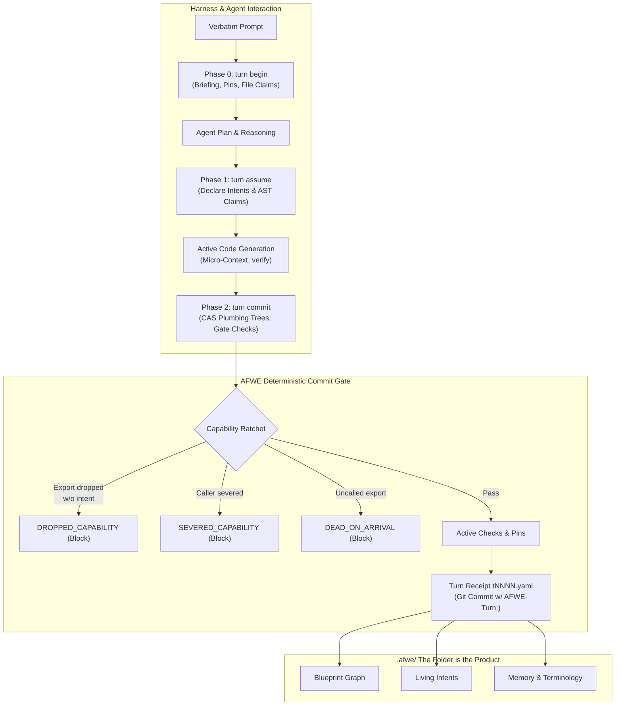

# AFWE Ubiquitous Language Dictionary

> **Canonical Domain Glossary & Semantic Model for AFWE-Core & AFWE-Client**
>
> In Domain-Driven Design (DDD), the **Ubiquitous Language** provides an unambiguous, shared vocabulary between software architects, human developers, agent harnesses, tools, and code. All agents MUST consult and preserve this language across plans, intents, code generation, and pull requests.

## Domain Model & Architectural Lifecycle

## Quick Reference Table

| Term | Category | Meaning Summary | Not To Be Confused With |
| :--- | :--- | :--- | :--- |
| [**4D Timeline Dial**](#4d-timeline-dial) | Architecture Philosophy & Tenets | A continuous temporal scrubber control (`TimelineScrubber4D.tsx`) that treats time as a spatial coordinate. Moving backward inspects historical architecture snapshots; moving forward into the future renders planned architectural nodes as translucent "ghost nodes" based on active intent roadmaps and forward constraints. | Dual Timeline Scrubber |
| [**Action Queue**](#action-queue) | Architecture Philosophy & Tenets | # Action Queue | — |
| [**Ambiguity Question**](#ambiguity-question) | Confidence Bands & Calibration | A high-blast-radius architectural dilemma generated when system confidence falls below 85% (`afwe question list`). Instead of making an unverified guess, AFWE pauses and queues the question for human architect confirmation, persisting the resolution into memory or pins. | Probing Guide |
| [**Asset Arena**](#asset-arena) | Memory, Pins & Living Intents | # Asset Arena | — |
| [**Bearer Token**](#bearer-token) | Architecture Philosophy & Tenets | # Bearer Token | — |
| [**Blueprint**](#blueprint) | Blueprint & Cartography | The deterministic hierarchical architecture tree defining the product's structure, declared across `afwe.yaml` and `.afwe/blueprint/` (`blueprint.yaml`, `relations.yaml`, `constraints.yaml`). It maps code files and symbols to architectural nodes, defines permitted relationships, and sets boundaries. | Index |
| [**Blueprint Diff View**](#blueprint-diff-view) | Blueprint & Cartography | A dedicated architectural visualizer in Studio Timeline (`TimelinePage.tsx`) that renders the structural delta between two turns or branches. It color-codes added nodes/relations (green), modified boundaries (amber), and removed entities (red), complementing textual source code diffs with structural architecture diffs. | Code Diff Viewer |
| [**Blueprint Node**](#blueprint-node) | Blueprint & Cartography | An architectural entity within the Blueprint tree representing a product, subsystem, module, or component. Each node has an ID, human-readable name, purpose statement, implementation mapping (file globs and symbols), status (`active`, `planned`, `deprecated`, `uncharted`), and architectural boundaries. | File / Directory |
| [**Blueprint View**](#blueprint-view) | Blueprint & Cartography | The primary structural graph visualizer in AFWE Studio (powered by `GraphView.tsx` and ReactFlow) rendering the Blueprint tree in balanced, tiered vertical strata. It features perimeter port distribution to eliminate edge overlap, switchable edge routing geometry (bezier, smoothstep, orthogonal), spacebar hand pan navigation, and progressive leaf disclosure. | Blueprint (Concept), Topology View |
| [**Capability Bridge**](#capability-bridge) | Ratchets & Integrity Verification | # Capability Bridge | — |
| [**Capability Ratchet**](#capability-ratchet) | Ratchets & Integrity Verification | A monotonic architectural safety mechanism enforced during `afwe turn commit`. It guarantees that codebase capabilities, public API exports, caller references, decisions, and documentation references can only advance or remain stable—never unintentionally degrade. Intentionally breaking a capability requires an explicit declaration in `turn assume`. | Unit Testing |
| [**Check**](#check) | Ratchets & Integrity Verification | An executable verification item registered in `.afwe/checks/*.yaml` evaluated during `afwe verify` and `afwe turn commit`. Checks possess trust ratings, explicit authorship (human, generator, agent), and deterministic pass/fail semantics. | Claim |
| [**CI Runner Profile & Cached Acquisition**](#ci-runner-profile-cached-acquisition) | Architecture Philosophy & Tenets | # CI Runner Profile & Cached Acquisition | — |
| [**Claim**](#claim) | Claims & Tripwires | A pre-generation assertion declared during Phase 1 (`afwe turn assume`) before code is written. Claims include: | Intent |
| [**Comment-Aware Claims**](#comment-aware-claims) | Claims & Tripwires | # Comment-Aware Claims | — |
| [**Component Inspector**](#component-inspector) | Architecture Philosophy & Tenets | The contextual metadata panel in AFWE Studio (`ComponentInspector.tsx` and `NodeInspector.tsx`) activated upon selecting any node or relation. It renders live purpose statements, implementation file/symbol mappings, caller counts, attached active guardrails, ADR decisions, bookmarks, and structural edit controls (`move`, `relate`, `constrain`). | Micro-Context |
| [**Concurrency Lease**](#concurrency-lease) | Multi-Agent Concurrency & Worktrees | A mutual exclusion mechanism (`afwe lease acquire <node>`) that grants temporary exclusive write permissions on specific Blueprint nodes and their mapped files to an agent or worktree, preventing concurrent agents from generating conflicting changes. | File Claim |
| [**Constellation View**](#constellation-view) | Architecture Philosophy & Tenets | A force-directed cosmic graph visualization in AFWE Studio (`ConstellationMap.tsx`) modeling architectural gravity, inter-module attraction, and constraint repulsion. It supports directional 3-hop Breadth-First Search (BFS), bidirectional cycle detection, generous 14px hitboxes for edge selection, and spatial drag clamping. | Topology View |
| [**Contention**](#contention) | Multi-Agent Concurrency & Worktrees | A concurrency conflict state returned when an agent attempts to begin a turn or acquire claims/leases on files or blueprint nodes already held by another active agent session. When contention occurs, the agent must defer, release overlapping claims, or coordinate via mission boundaries rather than overwriting concurrently. | Merge Conflict |
| [**Context Codename Separation**](#context-codename-separation) | Architecture Philosophy & Tenets | The strict architectural separation governing AFWE development between two distinct contexts: | Client/Server Networking |
| [**DEAD_ON_ARRIVAL**](#dead_on_arrival) | Ratchets & Integrity Verification | A blocking commit gate error triggered when a newly introduced exported function or capability is born with 0 callers and no tests exercising it, without an explicit intent declaration. | DROPPED_CAPABILITY |
| [**DOCS_DRIFT**](#docs_drift) | Ratchets & Integrity Verification | A commit gate error triggered when markdown documentation files (`README.md`, `docs/*.md`, `.afwe/docs/*.md`) contain broken links to code files, outdated symbol paths, or deleted source files. | Drift |
| [**DOTS Hierarchical Scene Graph**](#dots-hierarchical-scene-graph) | Architecture Philosophy & Tenets | # DOTS Hierarchical Scene Graph | — |
| [**Drift**](#drift) | Blueprint & Cartography | Any disagreement between the physical codebase (analyzed files, AST imports, symbol definitions) and the Blueprint tree. Detected via `afwe drift` or during `afwe sync`. Disagreements are triaged by confidence: | Constraint Violation |
| [**Drift Ledger**](#drift-ledger) | Architecture Philosophy & Tenets | # Drift Ledger | — |
| [**Drift Verdict**](#drift-verdict) | Architecture Philosophy & Tenets | # Drift Verdict | — |
| [**DROPPED_CAPABILITY**](#dropped_capability) | Ratchets & Integrity Verification | A blocking commit gate error triggered when an intra-file public export or capability is deleted or privatized without an explicit removal or replacement declared in `turn assume` (`removes: [...]` or `action: remove / replace`). | SEVERED_CAPABILITY |
| [**Dual Timeline Scrubber**](#dual-timeline-scrubber) | Architecture Philosophy & Tenets | An interactive dual-point range slider in AFWE Studio (`TimelineDualScrubber.tsx`) allowing developers to bind two separate moments in codebase history (Turn A vs Turn B). It dynamically updates the active map or diff viewer to compare structural graph transformations, capability gains, or collateral losses between those moments. | 4D Timeline Dial |
| [**Edge Routing Geometry**](#edge-routing-geometry) | Architecture Philosophy & Tenets | The configurable mathematical curvature options applied to relationship lines across Studio maps: | Constraint Violation Routing |
| [**Epoch ID**](#epoch-id) | Turn Protocol & Lifecycle | # Epoch ID | — |
| [**Explore Mode**](#explore-mode) | Confidence Bands & Calibration | A temporary mode activated via `afwe unlock --reason "..."` that downgrades blocking active checks and capability ratchets into non-blocking warnings during active exploratory refactoring or rapid prototyping. The harness must re-arm the gate before release via `afwe lock`, which triggers full architecture verification. | Bypassing the Gate |
| [**Git Channel**](#git-channel) | Architecture Philosophy & Tenets | # Git Channel | — |
| [**Guardrail**](#guardrail) | Architecture Philosophy & Tenets | An architectural constraint divided into two complementary forms: | Pin, Check |
| [**Harness-Agnostic Architecture**](#harness-agnostic-architecture) | Architecture Philosophy & Tenets | # Harness-Agnostic Architecture | — |
| [**Human Floor**](#human-floor) | Architecture Philosophy & Tenets | # Human Floor | — |
| [**Intent**](#intent) | Memory, Pins & Living Intents | A living, persistent statement of architectural purpose and desired behavior stored in `.afwe/intents/*.yaml`. Derived and merged from verbatim user prompts over time, intents capture what the codebase is intended to do, its historical evolution, and its implementation mappings. | Turn, Workflow |
| [**Materializer**](#materializer) | Claims & Tripwires | The engine component invoked via `afwe materialize` (or MCP `afwe_materialize`) that renders AFWE tripwires into native workspace files (`.git/hooks/pre-commit`, `.github/workflows/afwe-gate.yml`, native test suites, `AGENTS.md` markers, and `.afwe/checks/manifest.blake3`). It offers preview-first application (`--dry-run` by default) and rollback capabilities. | afwe init |
| [**Micro-Context**](#micro-context) | Blueprint & Cartography | The targeted, highly scoped architectural context retrieved via `afwe context <files>` (or MCP tool `afwe_context`). Before an agent touches a file, micro-context delivers only the nodes, purpose statements, decisions, exceptions, constraints, ubiquitous terminology, and active guardrails that directly apply to those specific files. | Whole-Repository Prompting |
| [**Mission**](#mission) | Multi-Agent Concurrency & Worktrees | A goal-oriented coordination structure stored in `.afwe/missions/*.yaml` that orchestrates multiple autonomous agents across isolated Git worktrees. Missions break complex epics into discrete turn obligations, managing concurrency leases, shared node boundaries, and merge gates. | Turn |
| [**Narrow Self-Heal**](#narrow-self-heal) | Architecture Philosophy & Tenets | # Narrow Self-Heal | — |
| [**Native Dot Notation**](#native-dot-notation) | Architecture Philosophy & Tenets | The canonical hierarchical address syntax (e.g., `afwe.Core.Analyze` or `project.Billing.Checkout`) used natively across AFWE Studio maps, CLI arguments, and engine queries. It mirrors namespace notation in modern languages, replacing fragile filesystem slash paths (`afwe/core/analyze`) with stable architectural node identities. | File System Paths |
| [**ORPHANED_DECISION**](#orphaned_decision) | Ratchets & Integrity Verification | A commit gate error triggered when an architectural decision record in `.afwe/memory/decisions/` is anchored to files or symbols that have been deleted or moved without updating or superseding the decision. | ORPHANED_PIN |
| [**ORPHANED_PIN**](#orphaned_pin) | Ratchets & Integrity Verification | A commit gate error triggered when a human-locked pin in `.afwe/pins/` targets architectural nodes, files, or symbols that no longer exist in the working tree. Pins require explicit human override or retirement. | ORPHANED_DECISION |
| [**Perimeter Port Distribution**](#perimeter-port-distribution) | Architecture Philosophy & Tenets | An architectural layout algorithm in Studio Blueprint and Topology views that dynamically distributes connection handle ports along all four perimeters (top, bottom, left, right) of node cards based on relative target angles. This eliminates overlapping edge bundles, prevents line crossings through node bodies, and maintains clean visual hierarchy. | Single-Anchor Ports |
| [**Phase 0 (Briefing & Pins)**](#phase-0-briefing-pins) | Turn Protocol & Lifecycle | The initial pre-planning phase of a turn initiated via `afwe turn begin "<prompt>" --target <files> [--claim <files>]`. It stores the prompt verbatim, generates a deterministic briefing pack including active pins, guardrails, memory, active intents, and probing guides, issues a bearer security token, and acquires upfront file claims to prevent multi-agent contention. | Phase 1 (turn assume) |
| [**Phase 1 (Pre-Code Declaration)**](#phase-1-pre-code-declaration) | Turn Protocol & Lifecycle | The pre-code declaration phase invoked via `afwe turn assume <turn> --file <json> [--token <tok>]`. Before any code is generated or edited, the agent explicitly registers its architectural intents, file claims, and pre-generation AST assertions (`forbid_import`, `forbid_symbol`, `export_exists`, `symbol_signature`, `pattern`, `command`). Intentional removals must be declared in `removes` to satisfy the strict "Rust for project intent" compiler model. | Phase 2 (turn commit) |
| [**Phase 2 (Gated Commit)**](#phase-2-gated-commit) | Turn Protocol & Lifecycle | The final gated commit phase invoked via `afwe turn commit <turn> --summary "..." [--token <tok>]`. AFWE isolates working changes via Git plumbing trees with Content-Addressable Storage (CAS) verification and advisory OS commit locks, executing the gate against active pins, claims, and capability ratchets before recording the turn in `.afwe/turns/` and emitting an `AFWE-Turn:` trailer. | git commit -m |
| [**Pin**](#pin) | Memory, Pins & Living Intents | A human-locked architectural decision or intentional bug stored in `.afwe/pins/*.yaml`. Pins represent immutable boundaries that automated agents and refactorings are strictly forbidden from breaking or deleting without an explicit override `{pin, reason}`. Pins are capped under a codebase-scaled budget to prevent architectural ossification. | Guardrail, Decision (Memory) |
| [**Presence Proof**](#presence-proof) | Architecture Philosophy & Tenets | # Presence Proof | — |
| [**Presence Watcher**](#presence-watcher) | Architecture Philosophy & Tenets | # Presence Watcher | — |
| [**Private Git Plumbing Tree**](#private-git-plumbing-tree) | Architecture Philosophy & Tenets | # Private Git Plumbing Tree | — |
| [**Probing Guide**](#probing-guide) | Confidence Bands & Calibration | An advisory architectural hint emitted in Phase 0 briefings with 85%–90% confidence (`[GUIDE - ADVISORY]`). Probing guides steer the agent toward emerging architectural patterns without hard-blocking execution. When repeatedly adhered to, probing guides graduate into active deterministic checks via `afwe guide graduate`. | Active Check, Ambiguity Question |
| [**Prompter Delegation**](#prompter-delegation) | Architecture Philosophy & Tenets | # Prompter Delegation | — |
| [**Quarantine Grace System**](#quarantine-grace-system) | Architecture Philosophy & Tenets | # Quarantine Grace System | — |
| [**Radial View**](#radial-view) | Architecture Philosophy & Tenets | A polar concentric cartographic visualization in AFWE Studio (`RadialMap.tsx`) organizing codebase depth into concentric rings. Root nodes sit at the center with child subsystems, modules, and component sectors radiating outward. It features power-law sector weighting, hover lineage ray tracing, autoscaling radial depth, and scaled arc typography. | Flame Graph, Blueprint View |
| [**Ratchet Baseline**](#ratchet-baseline) | Ratchets & Integrity Verification | A snapshot mechanism (`afwe baseline snapshot`) used when onboarding legacy codebases to grandfather pre-existing violations, uncalled exports, or circular imports without failing the gate. The gate prevents any *new* regressions from being introduced beyond the recorded baseline. | Ratchet |
| [**Ready Mode Checkgen**](#ready-mode-checkgen) | Architecture Philosophy & Tenets | # Ready Mode Checkgen | — |
| [**Rust for Project Intent**](#rust-for-project-intent) | Architecture Philosophy & Tenets | The foundational design philosophy of AFWE: applying the unforgiving, deterministic mental model of the Rust compiler to overall project architecture and intent. Under this paradigm, you can break things on purpose by declaring them explicitly in `turn assume` (`removes: [...]`), but the gate ensures you can never break things by accident. | Programming Language Choice |
| [**Scene Outliner**](#scene-outliner) | Architecture Philosophy & Tenets | The collapsible tree panel in AFWE Studio (`SceneOutliner.tsx`) displaying all entities, systems, and nodes registered in the DOTS Hierarchical Scene Graph. It provides immediate structural search, visibility toggling, multi-selection, and sync with the active spatial visualizer. | File Explorer |
| [**SEVERED_CAPABILITY**](#severed_capability) | Ratchets & Integrity Verification | A blocking commit gate error triggered when cross-module caller severance drops inbound references to an exported function or struct from >0 to 0, turning previously consumed functionality into dead code without declared intent. | DEAD_ON_ARRIVAL |
| [**Skipping Resistance**](#skipping-resistance) | Architecture Philosophy & Tenets | # Skipping Resistance | — |
| [**Spacebar Hand Pan**](#spacebar-hand-pan) | Architecture Philosophy & Tenets | A unified navigation paradigm across all AFWE Studio canvas visualizers (Blueprint, Topology, Radial, Constellation). Holding the `Spacebar` key or selecting the floating Hand Pan tool sets child element `pointer-events: none`, temporarily disabling node dragging, selection, and click interception so the user can fluidly pan the canvas without accidentally moving nodes or resetting zoom. | Node Dragging |
| [**Spatial Drag Clamping**](#spatial-drag-clamping) | Architecture Philosophy & Tenets | A bounding box and physics constraint mechanism in Studio Constellation and Topology maps that clamps manual node dragging within bounded spatial regions. It prevents developers from accidentally flinging nodes into infinite virtual coordinates or breaking parent cluster gravity. | Auto-Layout |
| [**String Interner**](#string-interner) | Memory, Pins & Living Intents | # String Interner | — |
| [**Sub-Turn**](#sub-turn) | Turn Protocol & Lifecycle | A granular, child execution unit operating underneath a parent turn (formatted as `<parent_turn>.<n>`, e.g., `t0046.1`). Sub-turns are used for atomic remediation actions such as Narrow Self-Heal file restorations (`afwe heal restore`), staged sub-steps within an autonomous multi-agent Mission, or isolated micro-commits that maintain cryptographic linkage to the parent turn without re-running full briefing packs. | Turn, Git Commit |
| [**The Folder is the Product**](#the-folder-is-the-product) | Architecture Philosophy & Tenets | The core tenet of AFWE stating that `.afwe/` itself is the persistent, tool-agnostic structural model of the project. The engine that reads and writes it (CLI, MCP, Studio) is completely replaceable; the folder, its yaml files, markdown memory, and git history remain the durable single source of architectural truth. | Ephemeral Cache or Lockfile |
| [**Timeline View**](#timeline-view) | Architecture Philosophy & Tenets | The chronological turn and intent auditing interface in AFWE Studio (`TimelinePage.tsx`). It visualizes turn history by intent, displays git commit receipts, tracks intent drift over time, provides side-by-side diff viewers (Code, Blueprint, Claims), and offers 3-way historical feature restoration (`afwe timeline restore`). | Action Queue, Git Log |
| [**Topology View**](#topology-view) | Blueprint & Cartography | A spatial visualizer in AFWE Studio rendering the codebase as a topological map of architectural subsystems, modules, and cross-boundary dependency flows. It highlights upward constraint violation curves in red, visualizes capability bridges, and supports double-click drill-down to the Constellation graph. | Blueprint View, Constellation View |
| [**Tripwire**](#tripwire) | Claims & Tripwires | A deterministic, preview-first defensive layer materialized directly into developer and CI harnesses (git hooks, GitHub Actions CI gates, native unit test harnesses, AGENTS.md blocks, and BLAKE3 manifests). Tripwires intercept architectural regressions outside of AFWE commands. | Passive Guardrail |
| [**Turn**](#turn) | Turn Protocol & Lifecycle | A discrete, atomic engineering lifecycle unit spanning exactly one prompt ("one prompt = one turn"). A turn progresses sequentially through three deterministic phases: Phase 0 (`afwe turn begin`) pre-planning briefing, Phase 1 (`afwe turn assume`) pre-code intent and claims declaration, and Phase 2 (`afwe turn commit`) post-verification gated commit via isolated Git plumbing trees with CAS verification. | Intent, Git Commit |
| [**Turn Abandon**](#turn-abandon) | Turn Protocol & Lifecycle | A turn cancellation command (`afwe turn abandon <turn>`) that discards an open uncommitted turn, immediately releasing all file claims, locks, and temporary token reservations without altering the Git tree. | Turn Redo |
| [**Turn Hash**](#turn-hash) | Turn Protocol & Lifecycle | # Turn Hash | — |
| [**Turn Pause**](#turn-pause) | Turn Protocol & Lifecycle | # Turn Pause | — |
| [**Turn Receipt**](#turn-receipt) | Turn Protocol & Lifecycle | The immutable record produced upon turn commit, saved in `.afwe/turns/tNNNN.yaml`. It contains the original prompt verbatim, origin, timing, gate evaluation, intent updates, files modified, checks executed, capability ratchets checked, and Git commit hash. | Intent |
| [**Turn Redo**](#turn-redo) | Turn Protocol & Lifecycle | A safety command (`afwe turn redo <turn>`) that cleanly reverts uncommitted workspace edits back to the turn's begin baseline (backed up in `.afwe/backups/<turn_hash>/`), while keeping the turn open and retaining locks for rework. | Turn Abandon, Turn Undo / Revert |
| [**Visualizer Switcher (4-Lens Overview)**](#visualizer-switcher-4-lens-overview) | Architecture Philosophy & Tenets | The segmented icon control bar on the AFWE Studio Overview page allowing instant hot-switching between the four core spatial perspectives: | Studio Page Navigation |

## Detailed Vocabulary by Category

### Architecture Philosophy & Tenets

#### 4D Timeline Dial 

- **ID**: `term-4d-timeline-dial`
- **Tags**: `studio-control`, `timeline`, `4d`
- **Applies to**: `studio`, `studio-timeline`

**Meaning:**
A continuous temporal scrubber control (`TimelineScrubber4D.tsx`) that treats time as a spatial coordinate. Moving backward inspects historical architecture snapshots; moving forward into the future renders planned architectural nodes as translucent "ghost nodes" based on active intent roadmaps and forward constraints.

**Not to be confused with:**
- **Dual Timeline Scrubber**: The Dual Scrubber compares two discrete turn receipts; the 4D Dial interpolates continuous temporal frames including future architectural directions.

---

#### Action Queue 

- **ID**: `term-action-queue`

**Meaning:**
# Action Queue

The deterministic, read-only 6-state governance view over turns, leases, and repository state, providing both humans and delegated orchestrators an actionable view of pending items without polling.

## The Six Canonical States
1. **STAGED**: Proposals parked awaiting confirmation or human-floor review.
2. **GHOST REDO**: Turns left in REDO state when work ceased without clean reset.
3. **READY**: Evaluated turns where checks passed, sitting in the Ready drawer for git commit.
4. **ADVISORY DRIFT**: Non-blocking architectural violations and documentation drift.
5. **STALE NODE LEASES**: Concurrency node leases whose leaseholder heartbeats have lapsed.
6. **UNATTRIBUTED**: Working-tree modifications or commits lacking AFWE turn attribution.

## Interfaces
- **Studio Web / Tauri**: Real-time visual cards with state filters and batch action bars.
- **Terminal Surface**: Live ANSI dashboard via `afwe watch`.
- **MCP Tooling**: Headless programmatic inspection and resolution via `afwe_queue_get`, `afwe_queue_act`, and `afwe_batch_act`.

---

#### Bearer Token 

- **ID**: `term-bearer-token`
- **Tags**: `[terminology, security, authentication, protocol]`

**Meaning:**
# Bearer Token

### Definition
An ephemeral, cryptographically random secret token generated at `afwe turn begin` and scoped to the active Turn lifecycle.

### Why it Matters
The Bearer Token ensures that only the authorized agent or process that initiated a Turn can assume intents, renew leases, or commit changes for that Turn. It guards against unauthorized writes, cross-subagent interference, and hijacked mutation workflows in multi-agent environments.

### Example in Practice
When an agent starts a Turn via `afwe turn begin "Refactor auth"`, AFWE issues a bearer token embedded in the briefing pack JSON response. Subsequent calls to `afwe turn assume` and `afwe turn commit` validate this token before granting state modifications.

---

#### CI Runner Profile & Cached Acquisition 

- **ID**: `term-ci-runner-profile`

**Meaning:**
# CI Runner Profile & Cached Acquisition

The production CI configuration schema and binary acquisition strategy that guarantees fast, deterministic architectural gating on pull requests and pushes.

## Core Rules
1. **Configurable Runner Label**: `manifest.ci.runs_on` specifies the target runner (e.g. `blacksmith-4vcpu-ubuntu-2404`, defaulting to `ubuntu-latest`).
2. **Fixed Check Name**: The GitHub Actions job name is strictly fixed to `afwe-gate` to ensure repository branch protection requirements never break when runners or configurations shift.
3. **Fast Binary Acquisition**: Uses GitHub Actions caching (`actions/cache@v4`) and pinned prebuilt release downloads with SHA-256 checksum verification before falling back to compilation.
4. **Full History & Turn Records**: Enforces `fetch-depth: 0` and verifies that commit trailers have corresponding turn records committed in `.afwe/turns/`.

---

#### Component Inspector 

- **ID**: `term-component-inspector`
- **Tags**: `studio-panel`, `inspector`
- **Applies to**: `studio`, `studio-inspector`

**Meaning:**
The contextual metadata panel in AFWE Studio (`ComponentInspector.tsx` and `NodeInspector.tsx`) activated upon selecting any node or relation. It renders live purpose statements, implementation file/symbol mappings, caller counts, attached active guardrails, ADR decisions, bookmarks, and structural edit controls (`move`, `relate`, `constrain`).

**Not to be confused with:**
- **Micro-Context**: Micro-context is the formatted markdown context delivered to coding agents before editing; the Component Inspector is the visual GUI interface for developers in Studio.

---

#### Constellation View 

- **ID**: `term-constellation-view`
- **Tags**: `studio-view`, `visualization`, `constellation`
- **Applies to**: `studio`, `studio-maps`

**Meaning:**
A force-directed cosmic graph visualization in AFWE Studio (`ConstellationMap.tsx`) modeling architectural gravity, inter-module attraction, and constraint repulsion. It supports directional 3-hop Breadth-First Search (BFS), bidirectional cycle detection, generous 14px hitboxes for edge selection, and spatial drag clamping.

**Not to be confused with:**
- **Topology View**: Topology organizes nodes into deterministic rectangular cards in architectural strata; Constellation allows organic physics-driven clustering and orbit visualization.

---

#### Context Codename Separation 

- **ID**: `term-context-separation`
- **Tags**: `architecture-philosophy`, `repository-rules`
- **Applies to**: `afwe-core`, `afwe-cli`

**Meaning:**
The strict architectural separation governing AFWE development between two distinct contexts:
1. **AFWE-Core**: This engine repository, its Rust crates (`afwe-core`, `afwe-cli`), binaries, MCP server, Studio, and master documentation in `docs/` and `crates/`.
2. **AFWE-Client**: Consumer codebases initialized with `afwe init` or `afwe onboard`, whose scaffolds and templates live inside `.afwe/`. Client docs and generator templates must always reference `.afwe/docs/TUTORIAL.md`, never root `docs/`.

**Not to be confused with:**
- **Client/Server Networking**: This is not a network protocol; it is an architectural contract distinguishing engine authoring from client consumer scaffolding.

---

#### DOTS Hierarchical Scene Graph 

- **ID**: `term-dots-scene-graph`
- **Tags**: `[terminology, studio, architecture, rendering]`

**Meaning:**
# DOTS Hierarchical Scene Graph

### Definition
A high-performance, Data-Oriented Technology Stack (DOTS) inspired hierarchical graph model that organizes and computes transformation matrices, node hierarchies, and spatial bounds for visual rendering in AFWE Studio.

### Why it Matters
As repositories grow to thousands of blueprint nodes, capabilities, and dependencies, traditional object-oriented DOM or tree representations experience severe frame drops and memory overhead. The DOTS scene graph stores entity attributes in flat, contiguous memory arrays, allowing 60 FPS spatial rendering, instant level-of-detail culling, and rapid topological queries.

### Example in Practice
When Studio renders a repository with 500 modules and 2,000 edge connections in Blueprint View, the DOTS Hierarchical Scene Graph evaluates transform hierarchies in parallel passes, batching canvas draw calls without traversing individual nested object trees.

---

#### Drift Ledger 

- **ID**: `term-drift-ledger`

**Meaning:**
# Drift Ledger

## Definition
The **Drift Ledger** is a versioned state repository located at `.afwe/state/drift_ledger.json` that stores all tolerated drift occurrences along with their entry timestamps, target paths, rationale, and expiration deadlines.

## Behavior
- **Toleration Window**: Governed by `policy.drift_tolerate_days` (default 7 days, configurable up to 14 days in `afwe.yaml`).
- **Amber Re-surfacing**: Once the toleration deadline elapses, the engine elevates the drift from silent tracking to an Amber warning in the Action Queue (`ToleratedDriftExpired`), prompting the developer to either formalize adoption, trigger a steering turn, or extend toleration.
- **Batch Processing**: Supports bulk operations (`batch.tolerate_drift`, `batch.adopt_drift`) for high-velocity refactorings.

---

#### Drift Verdict 

- **ID**: `term-drift-verdict`

**Meaning:**
# Drift Verdict

## Definition
A **Drift Verdict** is an explicit tri-state governance action required whenever code deviates structurally from declared architectural blueprints without an automated mechanical rename match ($\ge 90\%$).

## The 3 Verdict Pathways
1. **Adopt**: Accepts the code mutation into the architectural blueprint. Optionally flags the change for fine-tuning (`tune: true`), generating a tracking card in the governance board.
2. **Reject**: Declines the drift. Either restores the exact pre-drift baseline bytes (`Restore`) or spawns an isolated remediation turn (`Steer` / `Rewrite`) with batch queue support.
3. **Tolerate**: Acknowledges the divergence without mutating the blueprint or failing gates, recording the drift into the Drift Ledger for a configurable grace window (default 7 days, up to 14 days) before surfacing as Amber for review.

---

#### Dual Timeline Scrubber 

- **ID**: `term-dual-timeline-scrubber`
- **Tags**: `studio-control`, `timeline`, `scrubbing`
- **Applies to**: `studio`, `studio-timeline`

**Meaning:**
An interactive dual-point range slider in AFWE Studio (`TimelineDualScrubber.tsx`) allowing developers to bind two separate moments in codebase history (Turn A vs Turn B). It dynamically updates the active map or diff viewer to compare structural graph transformations, capability gains, or collateral losses between those moments.

**Not to be confused with:**
- **4D Timeline Dial**: The 4D Dial scrubs through time linearly to see the past or projected future ghost nodes; the Dual Scrubber selects a bounded range between two arbitrary turns for side-by-side comparative diffing.

---

#### Edge Routing Geometry 

- **ID**: `term-edge-routing`
- **Tags**: `studio-layout`, `edge-routing`
- **Applies to**: `studio`, `studio-maps`

**Meaning:**
The configurable mathematical curvature options applied to relationship lines across Studio maps:
- **Smoothstep**: Right-angled orthogonal lines with rounded corners, ideal for tiered blueprint strata.
- **Bezier**: Smooth cubic polynomial curves, ideal for organic dependency networks.
- **Straight**: Direct Euclidean line segments, ideal for dense constellation networks.

**Not to be confused with:**
- **Constraint Violation Routing**: Normal edges use theme-accented neutral tones; violated edges are routed in bright red with upward curves and pulsing warning badges.

---

#### Git Channel 

- **ID**: `term-git-channel`

**Meaning:**
# Git Channel

A zero-relay remote communication protocol connecting inbound-restricted sandboxes, cloud agents, and containers to the human prompter. The engine writes structured queue facts to `refs/afwe/outbox/<project>` via lightweight git blobs (without growing commit history), while the presence watcher reads outbox updates via `git ls-remote` and transmits human steering replies through `refs/afwe/inbox/<project>`.

---

#### Guardrail 

- **ID**: `term-guardrail`
- **Tags**: `guardrails`, `verification`
- **Applies to**: `afwe-core`, `afwe-cli`

**Meaning:**
An architectural constraint divided into two complementary forms:
1. **Passive Guardrail**: Targeted contextual instructions injected into the agent's micro-context (`afwe context <files>`) before editing begins.
2. **Active Guardrail**: Concrete test, AST inspection, or claim enforced by `afwe verify` and the commit gate.

**Not to be confused with:**
- **Pin**: Guardrails can be generated, calibrated, and updated by AFWE tools; Pins are locked by humans under a strict budget.
- **Check**: A Check is the concrete executable assertion registered in the gate registry implementing an active guardrail or assumption claim.

---

#### Harness-Agnostic Architecture 

- **ID**: `term-harness-agnostic`

**Meaning:**
# Harness-Agnostic Architecture

The architectural invariant that AFWE core, verification, and tripwires operate identically regardless of which AI coding agent or human is executing changes (e.g. Claude Code, Cursor, Windsurf, Aider, OpenCode, custom MCP agents, or human developers).

## Principles
1. **Zero Vendor Lock-in**: AFWE core contains no proprietary harness SDKs or vendor-specific execution branches.
2. **Layered Hook Fallback**: Tool hooks (`agent-hooks.json`, `claude-hooks.json`) provide low-latency feedback; native Git pre-commit hooks (`.afwe/guardrails/pre-commit`) and the CI gate (`afwe-gate`) act as deterministic fallbacks for any environment lacking tool hooks.
3. **Open Standards**: Interoperates via standard JSON-RPC, standard CLI interfaces, and Git porcelain/plumbing.

---

#### Human Floor 

- **ID**: `term-human-floor`

**Meaning:**
# Human Floor

Non-delegable invariants and policy thresholds that cannot be auto-approved or bypassed by any delegated agent prompter, regardless of active delegation budgets.

## Human Floor Triggers (R8)
- Changes touching policy pins or root architecture governance.
- Large blast radius operations crossing multiple major subsystem boundaries.
- Remediations outside the narrow self-heal allowlist.
- Authority mode changes or lease delegation grants.

When a turn triggers a human floor, it is parked as `STAGED` with `requires_human: true`. The orchestrator agent skips the turn and continues its loop without stalling.

---

#### Narrow Self-Heal 

- **ID**: `term-self-heal`

**Meaning:**
# Narrow Self-Heal

A strictly bounded, recorded sub-turn remediation mechanism where AFWE executes mechanical corrective actions without authoring new source code.

## Section 0 Scope Boundary
- **Restores of Dropped Files**: Restoring an unchanged file from recorded baseline bytes is allowlisted because no foreign bytes are introduced (derivability check passes).
- **Sub-Turn Audit Trail**: Executed as a recorded child turn `<parent_turn>.1` with CAS validation and an explicit undo recipe.
- **Out of Scope**: Severed capabilities (missing wiring), semantic merges of modified files, and autonomous source generation are strictly forbidden inside `afwe-core`.

---

#### Native Dot Notation 

- **ID**: `term-native-dot-notation`
- **Tags**: `syntax`, `node-addressing`
- **Applies to**: `afwe-core`, `studio`, `afwe-cli`

**Meaning:**
The canonical hierarchical address syntax (e.g., `afwe.Core.Analyze` or `project.Billing.Checkout`) used natively across AFWE Studio maps, CLI arguments, and engine queries. It mirrors namespace notation in modern languages, replacing fragile filesystem slash paths (`afwe/core/analyze`) with stable architectural node identities.

**Not to be confused with:**
- **File System Paths**: File system paths (`src/billing/checkout.ts`) locate files on disk; Native Dot Notation addresses abstract Blueprint nodes regardless of file moves.

---

#### Perimeter Port Distribution 

- **ID**: `term-perimeter-port-distribution`
- **Tags**: `studio-layout`, `edge-routing`
- **Applies to**: `studio`, `studio-maps`

**Meaning:**
An architectural layout algorithm in Studio Blueprint and Topology views that dynamically distributes connection handle ports along all four perimeters (top, bottom, left, right) of node cards based on relative target angles. This eliminates overlapping edge bundles, prevents line crossings through node bodies, and maintains clean visual hierarchy.

**Not to be confused with:**
- **Single-Anchor Ports**: Traditional flow diagrams route all inputs through the top center and outputs through the bottom center; Perimeter Port Distribution balances connections across the entire node perimeter.

---

#### Presence Proof 

- **ID**: `term-presence-proof`

**Meaning:**
# Presence Proof

A hardware/OS biometric or credential prompt (Windows Hello, Touch ID, or system password challenge) invoked before executing high-blast-radius human-floor actions or override approvals. Under the settled `floor_only` default, routine turns, ready commits, and steering replies remain frictionless 1-click actions, while attempts by local agents or synthetic clicks to lower authority or override architectural pins require undeniable physical human confirmation.

---

#### Presence Watcher 

- **ID**: `term-presence-watcher`

**Meaning:**
# Presence Watcher

A lightweight, zero-GUI background daemon (`afwe presence run`) started at user login via OS autostart (Windows Scheduled Task, macOS LaunchAgent, Linux systemd user service). It monitors registered repositories listed in the user-level project registry, streams sequenced lifecycle events, applies user notification routing policies (`presence.toml`), and raises OS notifications or spawns compact always-on-top cards without stealing active typing focus.

---

#### Private Git Plumbing Tree 

- **ID**: `term-git-plumbing-tree`
- **Tags**: `[terminology, git, isolation, storage, safety]`

**Meaning:**
# Private Git Plumbing Tree

### Definition
An isolated, content-addressed Git object tree constructed directly using low-level Git plumbing commands (`git write-tree`, `git commit-tree`, `git update-ref`) without modifying the developer's active working tree or index.

### Why it Matters
Autonomous agent mutations must be verified, diffed, and staged in hermetic isolation before touching the developer's dirty workspace. By writing directly to private plumbing trees, AFWE can calculate exact CAS diffs, run verification checks, and stage proposals with zero interference with uncommitted human changes.

### Example in Practice
During `afwe turn commit`, the engine builds a tree object representing the staged turn changes and records it under `.afwe/refs/turns/<turn-id>`, keeping the developer's working directory untouched until an explicit merge or checkout is requested.

---

#### Prompter Delegation 

- **ID**: `term-prompter-delegation`

**Meaning:**
# Prompter Delegation

A time-bounded, permission-bounded grant from a human prompter to an orchestrator agent (`authority.delegate`), distinct from node concurrency leases (`lease.rs`).

## Key Properties
- **Deterministic Default**: The system starts and defaults to `human_only`.
- **Standalone Request**: Promotion/delegation can only be granted before work begins, by a human, as a standalone request with no other payload (R1-R3).
- **Idle Window Invariant (R4)**: Prompter delegation is forbidden while any turn is actively `open` (ready turns in the Ready drawer do not block).
- **Hard Ceilings (R5)**: Maximum TTL of 12 hours (default 4h), max auto-approvals of 50 (default 20), max self-heals of 10 (default 5).
- **Fail-Closed Fallback (R6)**: Any rejected attempt to loosen authority immediately revokes any active delegation and restores `human_only`.
- **Instant Revocation (R7)**: May be revoked at any time from any interface via `afwe authority revoke`.

---

#### Quarantine Grace System 

- **ID**: `term-quarantine-grace-system`
- **Tags**: `[terminology, safety, rollback, recovery]`

**Meaning:**
# Quarantine Grace System

### Definition
A two-tier safety mechanism that holds unverified or speculative agent mutations in an isolated quarantine state before permanent application or destruction, providing a configurable grace window for inspection and rollback.

### Why it Matters
Autonomous agent loops occasionally generate malformed, dead-on-arrival, or hallucinated outputs. The Quarantine Grace System ensures that accidental or destructive changes do not immediately overwrite working tree state or corrupt the project history, offering non-destructive recovery.

### Example in Practice
When an agent attempts to abandon or overwrite a modified file during a contentious turn, the engine places the replaced bytes into `.afwe/quarantine/<timestamp>/` rather than discarding them immediately, retaining a safety grace buffer.

---

#### Radial View 

- **ID**: `term-radial-view`
- **Tags**: `studio-view`, `visualization`, `radial`
- **Applies to**: `studio`, `studio-maps`

**Meaning:**
A polar concentric cartographic visualization in AFWE Studio (`RadialMap.tsx`) organizing codebase depth into concentric rings. Root nodes sit at the center with child subsystems, modules, and component sectors radiating outward. It features power-law sector weighting, hover lineage ray tracing, autoscaling radial depth, and scaled arc typography.

**Not to be confused with:**
- **Flame Graph**: A flame graph displays call stack execution time or profiling samples; Radial View displays static hierarchical architectural depth and boundary distribution.
- **Blueprint View**: Radial View uses polar polar coordinates (angles and radiuses); Blueprint View uses Cartesian tiered strata.

---

#### Ready Mode Checkgen 

- **ID**: `term-ready-mode-checkgen`
- **Tags**: `[terminology, checks, compilation, automation]`

**Meaning:**
# Ready Mode Checkgen

### Definition
An automated generator that compiles blueprint invariants, capability contracts, and lint specifications into deterministic, executable test checks whenever a project transitions into or operates in "Ready Mode".

### Why it Matters
Manual maintenance of CI check scripts frequently lags behind architectural evolution. Ready Mode Checkgen dynamically inspects the blueprint topology and synthesizes hermetic verification scripts ensuring that every active capability has an active check before code changes can be committed.

### Example in Practice
When a developer adds a new capability `ExportSvg` to the Studio node in `blueprint.dot`, Ready Mode Checkgen immediately emits an automated tripwire check verifying the export function signature and CAS output format.

---

#### Rust for Project Intent 

- **ID**: `term-rust-for-project-intent`
- **Tags**: `architecture-philosophy`, `compiler-mental-model`
- **Applies to**: `afwe-core`, `afwe-cli`

**Meaning:**
The foundational design philosophy of AFWE: applying the unforgiving, deterministic mental model of the Rust compiler to overall project architecture and intent. Under this paradigm, you can break things on purpose by declaring them explicitly in `turn assume` (`removes: [...]`), but the gate ensures you can never break things by accident.

**Not to be confused with:**
- **Programming Language Choice**: This refers to the architectural design philosophy of strictness and explicit declaration, regardless of what programming language the user's project uses.

---

#### Scene Outliner 

- **ID**: `term-scene-outliner`
- **Tags**: `studio-panel`, `dots`, `outliner`
- **Applies to**: `studio`, `studio-shell`

**Meaning:**
The collapsible tree panel in AFWE Studio (`SceneOutliner.tsx`) displaying all entities, systems, and nodes registered in the DOTS Hierarchical Scene Graph. It provides immediate structural search, visibility toggling, multi-selection, and sync with the active spatial visualizer.

**Not to be confused with:**
- **File Explorer**: A file explorer navigates disk directories; the Scene Outliner navigates logical architectural entities mapped across single or multiple files.

---

#### Skipping Resistance 

- **ID**: `term-skipping-resistance`

**Meaning:**
# Skipping Resistance

Tripwire mechanisms ensuring that agents and developers cannot bypass architectural governance by circumventing AFWE CLI calls.

## Core Tripwires (Section 6A)
- **CI Gate Trailer Check**: `afwe gate --ci` validates that git commits have valid `AFWE-Turn-Hash` and `AFWE-Turn` trailers matching recorded commit trees.
- **Unattributed Work Scanner**: Scans working tree changes and flags unmapped modifications as `UNATTRIBUTED` in the Action Queue.
- **Retroactive Attribution**: `afwe attribute <commit>` allows manual developer commits to be safely and legitimately incorporated into the AFWE audit trail.

---

#### Spacebar Hand Pan 

- **ID**: `term-spacebar-hand-pan`
- **Tags**: `studio-control`, `navigation`, `viewport`
- **Applies to**: `studio`, `studio-maps`

**Meaning:**
A unified navigation paradigm across all AFWE Studio canvas visualizers (Blueprint, Topology, Radial, Constellation). Holding the `Spacebar` key or selecting the floating Hand Pan tool sets child element `pointer-events: none`, temporarily disabling node dragging, selection, and click interception so the user can fluidly pan the canvas without accidentally moving nodes or resetting zoom.

**Not to be confused with:**
- **Node Dragging**: Normal left-click drags nodes to reposition them; Spacebar Pan navigates the entire viewport camera without altering node coordinates.

---

#### Spatial Drag Clamping 

- **ID**: `term-spatial-drag-clamping`
- **Tags**: `studio-physics`, `interaction`
- **Applies to**: `studio`, `studio-maps`

**Meaning:**
A bounding box and physics constraint mechanism in Studio Constellation and Topology maps that clamps manual node dragging within bounded spatial regions. It prevents developers from accidentally flinging nodes into infinite virtual coordinates or breaking parent cluster gravity.

**Not to be confused with:**
- **Auto-Layout**: Auto-layout computes resting node coordinates automatically; Spatial Drag Clamping bounds human interactive dragging within reasonable limits.

---

#### The Folder is the Product 

- **ID**: `term-the-folder-is-the-product`
- **Tags**: `architecture-philosophy`, `persistent-model`
- **Applies to**: `afwe-core`, `afwe-cli`

**Meaning:**
The core tenet of AFWE stating that `.afwe/` itself is the persistent, tool-agnostic structural model of the project. The engine that reads and writes it (CLI, MCP, Studio) is completely replaceable; the folder, its yaml files, markdown memory, and git history remain the durable single source of architectural truth.

**Not to be confused with:**
- **Ephemeral Cache or Lockfile**: `.afwe/` (excluding gitignored `index/` and `state/`) is committed to version control and represents the living architecture of the codebase.

---

#### Timeline View 

- **ID**: `term-timeline-view`
- **Tags**: `studio-view`, `timeline`, `ledger`
- **Applies to**: `studio`, `studio-timeline`

**Meaning:**
The chronological turn and intent auditing interface in AFWE Studio (`TimelinePage.tsx`). It visualizes turn history by intent, displays git commit receipts, tracks intent drift over time, provides side-by-side diff viewers (Code, Blueprint, Claims), and offers 3-way historical feature restoration (`afwe timeline restore`).

**Not to be confused with:**
- **Action Queue**: Timeline View audits past historical executed turns; Action Queue displays live, pending operational tasks and proposals.
- **Git Log**: Standard git log only shows commits; Timeline View shows turns, prompt provenance, gate evaluations, and intent mutations.

---

#### Visualizer Switcher (4-Lens Overview) 

- **ID**: `term-visualizer-switcher`
- **Tags**: `studio-shell`, `overview`, `lenses`
- **Applies to**: `studio`, `studio-shell`

**Meaning:**
The segmented icon control bar on the AFWE Studio Overview page allowing instant hot-switching between the four core spatial perspectives:
1. **Blueprint**: Tiered structural hierarchy.
2. **Topology**: Strata-based dependency networks and violation curves.
3. **Radial**: Polar depth and concentric sector arcs.
4. **Constellation**: Force-directed celestial gravity and clustering.

**Not to be confused with:**
- **Studio Page Navigation**: Page navigation moves between high-level tabs (Overview, Timeline, Checks, Decisions, Settings); the Visualizer Switcher alternates lenses within the Overview workspace.

---

### Confidence Bands & Calibration

#### Ambiguity Question 

- **ID**: `term-ambiguity-question`
- **Tags**: `confidence-bands`, `human-in-the-loop`
- **Applies to**: `afwe-core`, `afwe-cli`

**Meaning:**
A high-blast-radius architectural dilemma generated when system confidence falls below 85% (`afwe question list`). Instead of making an unverified guess, AFWE pauses and queues the question for human architect confirmation, persisting the resolution into memory or pins.

**Not to be confused with:**
- **Probing Guide**: Probing guides (85%–90%) advise agents without blocking; Ambiguity Questions (<85%) halt high-risk forks for human judgment.

---

#### Explore Mode 

- **ID**: `term-explore-mode`
- **Tags**: `explore-mode`, `prototyping`
- **Applies to**: `afwe-core`, `afwe-cli`

**Meaning:**
A temporary mode activated via `afwe unlock --reason "..."` that downgrades blocking active checks and capability ratchets into non-blocking warnings during active exploratory refactoring or rapid prototyping. The harness must re-arm the gate before release via `afwe lock`, which triggers full architecture verification.

**Not to be confused with:**
- **Bypassing the Gate**: Explore Mode does not disable detection; it downgrades errors to warnings temporarily while recording the explicit reason in the log.

---

#### Probing Guide 

- **ID**: `term-probing-guide`
- **Tags**: `confidence-bands`, `advisory`
- **Applies to**: `afwe-core`, `afwe-cli`

**Meaning:**
An advisory architectural hint emitted in Phase 0 briefings with 85%–90% confidence (`[GUIDE - ADVISORY]`). Probing guides steer the agent toward emerging architectural patterns without hard-blocking execution. When repeatedly adhered to, probing guides graduate into active deterministic checks via `afwe guide graduate`.

**Not to be confused with:**
- **Active Check**: Active checks block the commit gate; Probing Guides are non-blocking advisory steering.
- **Ambiguity Question**: Questions have <85% confidence and require human decision; Probing Guides have 85%–90% confidence and steer agents automatically.

---

### Memory, Pins & Living Intents

#### Asset Arena 

- **ID**: `term-asset-arena`
- **Tags**: `[terminology, performance, memory, engine]`

**Meaning:**
# Asset Arena

### Definition
A contiguous memory pool and monotonic bump allocator used by the AFWE-Core engine and Studio to store, reuse, and bulk-deallocate graph assets, glyphs, and parsed syntax representations.

### Why it Matters
Frequent allocations and deallocations during rapid AST parsing and graph visualizer frames cause memory fragmentation and garbage collection pauses. The Asset Arena enables zero-fragmentation allocations during a Turn or rendering frame, deallocating the entire arena in a single step upon completion.

### Example in Practice
During an AST claim pass across 150 source files, tokens and syntax node records are allocated out of a dedicated Turn Asset Arena. Once claims are verified and cached, the entire arena resets instantly without invoking thousands of individual free operations.

---

#### Intent 

- **ID**: `term-intent`
- **Tags**: `intents`, `architecture`
- **Applies to**: `afwe-core`, `afwe-cli`

**Meaning:**
A living, persistent statement of architectural purpose and desired behavior stored in `.afwe/intents/*.yaml`. Derived and merged from verbatim user prompts over time, intents capture what the codebase is intended to do, its historical evolution, and its implementation mappings.

**Not to be confused with:**
- **Turn**: A Turn is a single transaction that fulfills or updates one or more intents.
- **Workflow**: In AFWE ReBorn, legacy workflow graphs have graduated into unified living intents.

---

#### Pin 

- **ID**: `term-pin`
- **Tags**: `pins`, `governance`
- **Applies to**: `afwe-core`, `afwe-cli`

**Meaning:**
A human-locked architectural decision or intentional bug stored in `.afwe/pins/*.yaml`. Pins represent immutable boundaries that automated agents and refactorings are strictly forbidden from breaking or deleting without an explicit override `{pin, reason}`. Pins are capped under a codebase-scaled budget to prevent architectural ossification.

**Not to be confused with:**
- **Guardrail**: Guardrails are automated passive contexts or active checks; Pins are human-locked authoritative invariants that cannot be altered without human override.
- **Decision (Memory)**: An ADR in memory documents reasoning; a Pin actively blocks the gate from passing if violated.

---

#### String Interner 

- **ID**: `term-string-interner`
- **Tags**: `[terminology, performance, memory, engine]`

**Meaning:**
# String Interner

### Definition
A core data structure that stores only a single copy of each unique string slice, mapping strings to compact 32-bit integer identifiers (`Symbol` or `StringId`).

### Why it Matters
Identifier names, file paths, and AST symbol names are repeated thousands of times across blueprints, claim trees, and telemetry traces. String interning reduces memory footprints by upwards of 80% and converts expensive string equality checks into instant $O(1)$ integer comparisons.

### Example in Practice
When AFWE checks node contention across 20 concurrent turns, matching node identifiers like `"crates/afwe-core/src/api.rs"` executes as a single integer comparison between two interned symbols, rather than comparing byte sequences.

---

### Blueprint & Cartography

#### Blueprint 

- **ID**: `term-blueprint`
- **Tags**: `blueprint`, `architecture-tree`
- **Applies to**: `afwe-core`, `afwe-cli`

**Meaning:**
The deterministic hierarchical architecture tree defining the product's structure, declared across `afwe.yaml` and `.afwe/blueprint/` (`blueprint.yaml`, `relations.yaml`, `constraints.yaml`). It maps code files and symbols to architectural nodes, defines permitted relationships, and sets boundaries.

**Not to be confused with:**
- **Index**: The index is derived AST metadata generated from code files; the Blueprint is the authoritative structural reality that code is measured against.

---

#### Blueprint Diff View 

- **ID**: `term-blueprint-diff-view`
- **Tags**: `studio-view`, `blueprint`, `diff`
- **Applies to**: `studio`, `studio-timeline`

**Meaning:**
A dedicated architectural visualizer in Studio Timeline (`TimelinePage.tsx`) that renders the structural delta between two turns or branches. It color-codes added nodes/relations (green), modified boundaries (amber), and removed entities (red), complementing textual source code diffs with structural architecture diffs.

**Not to be confused with:**
- **Code Diff Viewer**: Code Diff Viewer inspects textual line modifications in files; Blueprint Diff View inspects structural graph modifications in the architecture tree.

---

#### Blueprint Node 

- **ID**: `term-blueprint-node`
- **Tags**: `blueprint`, `topology`
- **Applies to**: `afwe-core`, `afwe-cli`

**Meaning:**
An architectural entity within the Blueprint tree representing a product, subsystem, module, or component. Each node has an ID, human-readable name, purpose statement, implementation mapping (file globs and symbols), status (`active`, `planned`, `deprecated`, `uncharted`), and architectural boundaries.

**Not to be confused with:**
- **File / Directory**: A node is a logical concept. While it maps to files, multiple files can form one module node, or a single file can contain multiple component symbols.

---

#### Blueprint View 

- **ID**: `term-blueprint-view`
- **Tags**: `studio-view`, `visualization`, `blueprint`
- **Applies to**: `studio`, `studio-maps`

**Meaning:**
The primary structural graph visualizer in AFWE Studio (powered by `GraphView.tsx` and ReactFlow) rendering the Blueprint tree in balanced, tiered vertical strata. It features perimeter port distribution to eliminate edge overlap, switchable edge routing geometry (bezier, smoothstep, orthogonal), spacebar hand pan navigation, and progressive leaf disclosure.

**Not to be confused with:**
- **Blueprint (Concept)**: The Blueprint is the authoritative tree data structure in `.afwe/blueprint/`; the Blueprint View is the interactive graphical representation inside Studio.
- **Topology View**: Blueprint View highlights parent-child structural ownership; Topology View highlights inter-module import and caller dependencies.

---

#### Drift 

- **ID**: `term-drift`
- **Tags**: `drift`, `reconciliation`
- **Applies to**: `afwe-core`, `afwe-cli`

**Meaning:**
Any disagreement between the physical codebase (analyzed files, AST imports, symbol definitions) and the Blueprint tree. Detected via `afwe drift` or during `afwe sync`. Disagreements are triaged by confidence:
- Confidence >= 90%: auto-reconciled.
- Confidence 50%–90%: presented as soft changes.
- Confidence < 50% or structural changes: staged as proposals awaiting human confirmation.

**Not to be confused with:**
- **Constraint Violation**: A constraint violation is an active rule failure (e.g., forbidden import); Drift is an unmapped or shifted structural divergence between code and blueprint.

---

#### Micro-Context 

- **ID**: `term-micro-context`
- **Tags**: `context`, `passive-guardrails`
- **Applies to**: `afwe-core`, `afwe-cli`

**Meaning:**
The targeted, highly scoped architectural context retrieved via `afwe context <files>` (or MCP tool `afwe_context`). Before an agent touches a file, micro-context delivers only the nodes, purpose statements, decisions, exceptions, constraints, ubiquitous terminology, and active guardrails that directly apply to those specific files.

**Not to be confused with:**
- **Whole-Repository Prompting**: Micro-context specifically avoids dumping the entire codebase or full architecture into the LLM context, keeping token usage low and focus razor-sharp.

---

#### Topology View 

- **ID**: `term-topology-view`
- **Tags**: `studio-view`, `visualization`, `topology`
- **Applies to**: `studio`, `studio-maps`

**Meaning:**
A spatial visualizer in AFWE Studio rendering the codebase as a topological map of architectural subsystems, modules, and cross-boundary dependency flows. It highlights upward constraint violation curves in red, visualizes capability bridges, and supports double-click drill-down to the Constellation graph.

**Not to be confused with:**
- **Blueprint View**: Blueprint View renders the static hierarchical containment tree; Topology View renders functional dependency and interaction networks across layers.
- **Constellation View**: Topology organizes components into structured architectural strata; Constellation uses force-directed physics.

---

### Ratchets & Integrity Verification

#### Capability Bridge 

- **ID**: `term-capability-bridge`
- **Tags**: `[terminology, architecture, capabilities, interoperability]`

**Meaning:**
# Capability Bridge

### Definition
An explicit adapter layer or interface mapping between decoupled subsystems, crates, or runtime boundaries (such as between the Rust AFWE-Core engine and the TypeScript Studio UI, or between MCP and the CLI).

### Why it Matters
Capability Bridges enforce capability contracts across language and transport boundaries. They prevent implicit API drift, validate serializable JSON-RPC schemas, and ensure that capabilities verified in the engine remain strictly aligned with user-facing tools and external clients.

### Example in Practice
The MCP server in `crates/afwe-cli/src/mcp.rs` serves as a Capability Bridge between the engine's core turn API (`crates/afwe-core/src/api.rs`) and external AI agent runners, exposing structured tools while preserving validation logic.

---

#### Capability Ratchet 

- **ID**: `term-capability-ratchet`
- **Tags**: `ratchet`, `verification`, `gate`
- **Applies to**: `afwe-core`, `afwe-cli`

**Meaning:**
A monotonic architectural safety mechanism enforced during `afwe turn commit`. It guarantees that codebase capabilities, public API exports, caller references, decisions, and documentation references can only advance or remain stable—never unintentionally degrade. Intentionally breaking a capability requires an explicit declaration in `turn assume`.

**Not to be confused with:**
- **Unit Testing**: Unit tests check functional runtime correctness; Capability Ratchets check static architectural reachability, export continuity, and reference graphs.

---

#### Check 

- **ID**: `term-check`
- **Tags**: `checks`, `gate`
- **Applies to**: `afwe-core`, `afwe-cli`

**Meaning:**
An executable verification item registered in `.afwe/checks/*.yaml` evaluated during `afwe verify` and `afwe turn commit`. Checks possess trust ratings, explicit authorship (human, generator, agent), and deterministic pass/fail semantics.

**Not to be confused with:**
- **Claim**: A Claim is an assertion declared during `turn assume`; once registered or graduated, it becomes an enforced Check in the registry.

---

#### DEAD_ON_ARRIVAL 

- **ID**: `term-dead-on-arrival`
- **Tags**: `ratchet`, `gate-error`
- **Applies to**: `afwe-core`, `afwe-cli`

**Meaning:**
A blocking commit gate error triggered when a newly introduced exported function or capability is born with 0 callers and no tests exercising it, without an explicit intent declaration.

**Not to be confused with:**
- **DROPPED_CAPABILITY**: DROPPED_CAPABILITY is an export that was deleted; DEAD_ON_ARRIVAL is a new export that was created but left orphaned and unused.

---

#### DOCS_DRIFT 

- **ID**: `term-docs-drift`
- **Tags**: `ratchet`, `documentation`, `gate-error`
- **Applies to**: `afwe-core`, `afwe-cli`

**Meaning:**
A commit gate error triggered when markdown documentation files (`README.md`, `docs/*.md`, `.afwe/docs/*.md`) contain broken links to code files, outdated symbol paths, or deleted source files.

**Not to be confused with:**
- **Drift**: Blueprint drift is code-to-blueprint divergence; DOCS_DRIFT is documentation-to-code divergence.

---

#### DROPPED_CAPABILITY 

- **ID**: `term-dropped-capability`
- **Tags**: `ratchet`, `gate-error`
- **Applies to**: `afwe-core`, `afwe-cli`

**Meaning:**
A blocking commit gate error triggered when an intra-file public export or capability is deleted or privatized without an explicit removal or replacement declared in `turn assume` (`removes: [...]` or `action: remove / replace`).

**Not to be confused with:**
- **SEVERED_CAPABILITY**: DROPPED_CAPABILITY occurs when the public export itself disappears; SEVERED_CAPABILITY occurs when external callers are disconnected.

---

#### ORPHANED_DECISION 

- **ID**: `term-orphaned-decision`
- **Tags**: `ratchet`, `memory`, `gate-error`
- **Applies to**: `afwe-core`, `afwe-cli`

**Meaning:**
A commit gate error triggered when an architectural decision record in `.afwe/memory/decisions/` is anchored to files or symbols that have been deleted or moved without updating or superseding the decision.

**Not to be confused with:**
- **ORPHANED_PIN**: ORPHANED_DECISION applies to ADR memory; ORPHANED_PIN applies to human-locked pins in `.afwe/pins/`.

---

#### ORPHANED_PIN 

- **ID**: `term-orphaned-pin`
- **Tags**: `ratchet`, `pins`, `gate-error`
- **Applies to**: `afwe-core`, `afwe-cli`

**Meaning:**
A commit gate error triggered when a human-locked pin in `.afwe/pins/` targets architectural nodes, files, or symbols that no longer exist in the working tree. Pins require explicit human override or retirement.

**Not to be confused with:**
- **ORPHANED_DECISION**: ORPHANED_PIN involves human-locked invariant pins; ORPHANED_DECISION involves persistent ADR memory records.

---

#### Ratchet Baseline 

- **ID**: `term-baseline`
- **Tags**: `ratchet`, `baseline`
- **Applies to**: `afwe-core`, `afwe-cli`

**Meaning:**
A snapshot mechanism (`afwe baseline snapshot`) used when onboarding legacy codebases to grandfather pre-existing violations, uncalled exports, or circular imports without failing the gate. The gate prevents any *new* regressions from being introduced beyond the recorded baseline.

**Not to be confused with:**
- **Ratchet**: The ratchet is the monotonic enforcement rule; the baseline is the grandfathered zero-point snapshot.

---

#### SEVERED_CAPABILITY 

- **ID**: `term-severed-capability`
- **Tags**: `ratchet`, `gate-error`
- **Applies to**: `afwe-core`, `afwe-cli`

**Meaning:**
A blocking commit gate error triggered when cross-module caller severance drops inbound references to an exported function or struct from >0 to 0, turning previously consumed functionality into dead code without declared intent.

**Not to be confused with:**
- **DEAD_ON_ARRIVAL**: SEVERED_CAPABILITY affects previously used code that lost its callers; DEAD_ON_ARRIVAL affects newly introduced code that was never called.

---

### Claims & Tripwires

#### Claim 

- **ID**: `term-claim`
- **Tags**: `claims`, `pre-generation`
- **Applies to**: `afwe-core`, `afwe-cli`

**Meaning:**
A pre-generation assertion declared during Phase 1 (`afwe turn assume`) before code is written. Claims include:
- `forbid_import`: prevents illegal cross-node imports.
- `forbid_symbol`: disallows blacklisted symbols or deprecated constructs.
- `export_exists`: guarantees expected public functions or types remain exposed.
- `symbol_signature`: verifies parameter and return types match contract specifications.
- `pattern`: applies regex checks with automatic comment blanking.
- `command`: executes a shell test command.
- File Claims: locks specific files to avoid concurrent edit collisions.

**Not to be confused with:**
- **Intent**: Intent states what behavior is desired; a Claim states concrete structural boundaries that code must satisfy.

---

#### Comment-Aware Claims 

- **ID**: `term-comment-aware-claims`
- **Tags**: `[terminology, claims, ast, verification]`

**Meaning:**
# Comment-Aware Claims

### Definition
A parsing strategy that blanks out, ignores, or differentiates code comments and docstrings when evaluating AST function boundaries, symbol claims, and diff contentions.

### Why it Matters
Naive regex or raw string search can falsely match commented-out code, references in documentation, or license headers as active symbols. Comment-aware claim extraction ensures that agents only claim and lock genuine semantic AST nodes, preventing false contention and allowing concurrent documentation updates without lock collisions.

### Example in Practice
If Agent A holds a claim on function `pub fn execute_turn()`, and Agent B modifies an architectural docstring referencing `execute_turn()` in another file, Comment-Aware Claims recognizes the mention as inert prose rather than a declaration lock violation.

---

#### Materializer 

- **ID**: `term-materializer`
- **Tags**: `materializer`, `tripwire`
- **Applies to**: `afwe-core`, `afwe-cli`

**Meaning:**
The engine component invoked via `afwe materialize` (or MCP `afwe_materialize`) that renders AFWE tripwires into native workspace files (`.git/hooks/pre-commit`, `.github/workflows/afwe-gate.yml`, native test suites, `AGENTS.md` markers, and `.afwe/checks/manifest.blake3`). It offers preview-first application (`--dry-run` by default) and rollback capabilities.

**Not to be confused with:**
- **afwe init**: `init` scaffolds `.afwe/`; `materialize` projects active tripwire enforcement into external files outside `.afwe/`.

---

#### Tripwire 

- **ID**: `term-tripwire`
- **Tags**: `tripwire`, `materializer`
- **Applies to**: `afwe-core`, `afwe-cli`

**Meaning:**
A deterministic, preview-first defensive layer materialized directly into developer and CI harnesses (git hooks, GitHub Actions CI gates, native unit test harnesses, AGENTS.md blocks, and BLAKE3 manifests). Tripwires intercept architectural regressions outside of AFWE commands.

**Not to be confused with:**
- **Passive Guardrail**: Passive guardrails advise the agent during context loading; Tripwires hard-block git commits, pushes, and CI builds if invariants fail.

---

### Multi-Agent Concurrency & Worktrees

#### Concurrency Lease 

- **ID**: `term-lease`
- **Tags**: `multi-agent`, `concurrency`
- **Applies to**: `afwe-core`, `afwe-cli`

**Meaning:**
A mutual exclusion mechanism (`afwe lease acquire <node>`) that grants temporary exclusive write permissions on specific Blueprint nodes and their mapped files to an agent or worktree, preventing concurrent agents from generating conflicting changes.

**Not to be confused with:**
- **File Claim**: A File Claim operates at the individual file path level during a turn; a Concurrency Lease operates at the architectural node level across multiple worktrees and missions.

---

#### Contention 

- **ID**: `term-contention`
- **Tags**: `multi-agent`, `concurrency`
- **Applies to**: `afwe-core`, `afwe-cli`

**Meaning:**
A concurrency conflict state returned when an agent attempts to begin a turn or acquire claims/leases on files or blueprint nodes already held by another active agent session. When contention occurs, the agent must defer, release overlapping claims, or coordinate via mission boundaries rather than overwriting concurrently.

**Not to be confused with:**
- **Merge Conflict**: Git merge conflict occurs after text has diverged; Contention is preemptively prevented before code generation starts.

---

#### Mission 

- **ID**: `term-mission`
- **Tags**: `multi-agent`, `coordination`
- **Applies to**: `afwe-core`, `afwe-cli`

**Meaning:**
A goal-oriented coordination structure stored in `.afwe/missions/*.yaml` that orchestrates multiple autonomous agents across isolated Git worktrees. Missions break complex epics into discrete turn obligations, managing concurrency leases, shared node boundaries, and merge gates.

**Not to be confused with:**
- **Turn**: A Turn is executed by a single agent for a single prompt; a Mission coordinates multiple agents and turns toward a composite outcome.

---

### Turn Protocol & Lifecycle

#### Epoch ID 

- **ID**: `term-epoch-id`
- **Tags**: `[terminology, lifecycle, orchestration, concurrency]`

**Meaning:**
# Epoch ID

### Definition
A monotonically incrementing or timestamped logical grouping identifier that clusters related Turns, sub-turns, and missions within a shared high-level objective.

### Why it Matters
When multiple agents or automated pipelines run in parallel across decoupled branches or worktrees, the Epoch ID enables collective rollbacks, cross-turn synchronization points, and coherent telemetry collation across all active worker instances.

### Example in Practice
An autonomous testing campaign might spin up four subagents across an Epoch tagged `epoch-20261031-1900`. If one subagent discovers an invariant breach, the orchestrator uses the Epoch ID to cancel or quarantine all active sub-turns associated with that mission cluster.

---

#### Phase 0 (Briefing & Pins) 

- **ID**: `term-phase-0-briefing`
- **Tags**: `turn-protocol`, `briefing`
- **Applies to**: `afwe-core`, `afwe-cli`

**Meaning:**
The initial pre-planning phase of a turn initiated via `afwe turn begin "<prompt>" --target <files> [--claim <files>]`. It stores the prompt verbatim, generates a deterministic briefing pack including active pins, guardrails, memory, active intents, and probing guides, issues a bearer security token, and acquires upfront file claims to prevent multi-agent contention.

**Not to be confused with:**
- **Phase 1 (turn assume)**: Phase 0 is read-only research and briefing before planning; Phase 1 is intent and claim declaration after planning is complete.

---

#### Phase 1 (Pre-Code Declaration) 

- **ID**: `term-phase-1-assume`
- **Tags**: `turn-protocol`, `intent-declaration`
- **Applies to**: `afwe-core`, `afwe-cli`

**Meaning:**
The pre-code declaration phase invoked via `afwe turn assume <turn> --file <json> [--token <tok>]`. Before any code is generated or edited, the agent explicitly registers its architectural intents, file claims, and pre-generation AST assertions (`forbid_import`, `forbid_symbol`, `export_exists`, `symbol_signature`, `pattern`, `command`). Intentional removals must be declared in `removes` to satisfy the strict "Rust for project intent" compiler model.

**Not to be confused with:**
- **Phase 2 (turn commit)**: Assume declares expectations before writing code; commit verifies compliance and writes Git trees after code is complete.

---

#### Phase 2 (Gated Commit) 

- **ID**: `term-phase-2-commit`
- **Tags**: `turn-protocol`, `verification`, `gate`
- **Applies to**: `afwe-core`, `afwe-cli`

**Meaning:**
The final gated commit phase invoked via `afwe turn commit <turn> --summary "..." [--token <tok>]`. AFWE isolates working changes via Git plumbing trees with Content-Addressable Storage (CAS) verification and advisory OS commit locks, executing the gate against active pins, claims, and capability ratchets before recording the turn in `.afwe/turns/` and emitting an `AFWE-Turn:` trailer.

**Not to be confused with:**
- **git commit -m**: Standard git commit operates without architectural validation; AFWE turn commit acts as a compiler gate enforcing capability preservation and intent adherence.

---

#### Sub-Turn 

- **ID**: `term-sub-turn`
- **Tags**: `turn-protocol`, `sub-turn`, `remediation`
- **Applies to**: `afwe-core`, `afwe-cli`

**Meaning:**
A granular, child execution unit operating underneath a parent turn (formatted as `<parent_turn>.<n>`, e.g., `t0046.1`). Sub-turns are used for atomic remediation actions such as Narrow Self-Heal file restorations (`afwe heal restore`), staged sub-steps within an autonomous multi-agent Mission, or isolated micro-commits that maintain cryptographic linkage to the parent turn without re-running full briefing packs.

**Not to be confused with:**
- **Turn**: A top-level Turn spans an entire developer prompt; a Sub-Turn is a child transaction executing a mechanical remediation or sub-task of that turn.
- **Git Commit**: While a sub-turn produces a Git tree object, it is tagged as a subordinate turn step in the AFWE audit ledger.

---

#### Turn 

- **ID**: `term-turn`
- **Tags**: `turn-protocol`, `core-lifecycle`
- **Applies to**: `afwe-core`, `afwe-cli`

**Meaning:**
A discrete, atomic engineering lifecycle unit spanning exactly one prompt ("one prompt = one turn"). A turn progresses sequentially through three deterministic phases: Phase 0 (`afwe turn begin`) pre-planning briefing, Phase 1 (`afwe turn assume`) pre-code intent and claims declaration, and Phase 2 (`afwe turn commit`) post-verification gated commit via isolated Git plumbing trees with CAS verification.

**Not to be confused with:**
- **Intent**: An Intent is a living, persistent statement of architectural purpose and desire. A Turn is a single transactional execution step that implements or updates intents.
- **Git Commit**: A Git commit is a low-level VCS snapshot. An AFWE Turn produces an isolated tree commit tagged with an `AFWE-Turn:` trailer only after passing through the full architectural gate, intent alignment, and capability ratchets.

---

#### Turn Abandon 

- **ID**: `term-turn-abandon`
- **Tags**: `turn-protocol`, `recovery`
- **Applies to**: `afwe-core`, `afwe-cli`

**Meaning:**
A turn cancellation command (`afwe turn abandon <turn>`) that discards an open uncommitted turn, immediately releasing all file claims, locks, and temporary token reservations without altering the Git tree.

**Not to be confused with:**
- **Turn Redo**: Abandon terminates the turn completely; Redo resets the workspace but preserves the open turn session.

---

#### Turn Hash 

- **ID**: `term-turn-hash`
- **Tags**: `[terminology, identity, integrity, protocol]`

**Meaning:**
# Turn Hash

### Definition
A cryptographic hash digest (derived via BLAKE3) calculated over the deterministic content of a Turn, including its turn ID, prompt, claims, assumption manifest, and baseline tree hash.

### Why it Matters
The Turn Hash provides content-addressable identity and tamper evidence for agent executions. It prevents replay attacks, ensures that modifications cannot be injected into an in-flight Turn without invalidating the working context, and enables deterministic verification of receipts across parallel subagents.

### Example in Practice
When `afwe turn begin` runs, an initial Turn Hash is calculated and stamped onto the briefing pack. At `afwe turn commit`, the final tree digest and diff are blended into the hash, recorded into `.afwe/receipts/t0057.json`, and cited in the Git commit trailer.

---

#### Turn Pause 

- **ID**: `term-turn-pause`

**Meaning:**
# Turn Pause

## Definition
**Turn Pause** is a first-class state within the AFWE turn lifecycle where an in-flight turn (`open`) transitions to `paused`. During a Turn Pause, the agent's MCP or runner tool suspends reactively without consuming LLM tokens, broadcasting a `mid_turn.pause` presence notification to the desktop and Studio HUD.

## Mechanics
- **Zero-Token Wait**: The engine or MCP runner holds the connection in a reactive loop with exponential backoff rather than polling prompts or invoking LLMs.
- **Interactive Options**: Provides structured option pills (e.g. choice alternatives), free-form reply steering, or Studio inspection.
- **Resumption**: Resumed via `afwe turn resume <turn> --reply "..."` or `/api/action?act=resume`, immediately waking the agent and injecting the human's choice or steering directive into the turn context.

---

#### Turn Receipt 

- **ID**: `term-turn-receipt`
- **Tags**: `turn-protocol`, `provenance`
- **Applies to**: `afwe-core`, `afwe-cli`

**Meaning:**
The immutable record produced upon turn commit, saved in `.afwe/turns/tNNNN.yaml`. It contains the original prompt verbatim, origin, timing, gate evaluation, intent updates, files modified, checks executed, capability ratchets checked, and Git commit hash.

**Not to be confused with:**
- **Intent**: The turn receipt is an immutable audit receipt of a single execution; intents are living state documents that evolve over time.

---

#### Turn Redo 

- **ID**: `term-turn-redo`
- **Tags**: `turn-protocol`, `recovery`
- **Applies to**: `afwe-core`, `afwe-cli`

**Meaning:**
A safety command (`afwe turn redo <turn>`) that cleanly reverts uncommitted workspace edits back to the turn's begin baseline (backed up in `.afwe/backups/<turn_hash>/`), while keeping the turn open and retaining locks for rework.

**Not to be confused with:**
- **Turn Abandon**: Redo keeps the turn open to try again; Abandon cancels the turn and releases all file claims and locks.
- **Turn Undo / Revert**: Undo/revert operates on already-committed turns; Redo operates on the current open uncommitted turn.

---

## Mandatory Agent Protocol & Synchronization Directives

All LLM coding agents interacting with this repository MUST comply with the following invariants:

1. **Pre-Planning Reading Mandate**: Always read `docs/UBIQUITOUS_LANGUAGE.md` (or `.afwe/docs/UBIQUITOUS_LANGUAGE.md`) during Phase 0 to ensure plans, terminology, and intent statements use canonical domain terms rather than generic software development clichés.
2. **Explicit Declaration for Removals**: AFWE adheres strictly to the **Rust for Project Intent** philosophy. If a capability, export, or component is deprecated or removed, it MUST be declared in `turn assume` under `removes: [...]` or with `action: remove / replace`. Regressions fail the gate unconditionally.
3. **Post-Turn Synchronization**: Whenever code changes introduce a new architectural concept, rename a domain primitive, or modify domain boundaries:
   - Create or update the corresponding term in `.afwe/memory/terminology/term-<name>.md`.
   - Update `docs/UBIQUITOUS_LANGUAGE.md` and `.afwe/docs/UBIQUITOUS_LANGUAGE.md`.
   - Re-generate the interactive HTML and documentation files by running `afwe memory sync-terms` (or `node scripts/sync-ubiquitous-language.js`).
   - Ensure `AGENTS.md` and `.afwe/skills/afwe/SKILL.md` remain synchronized.
