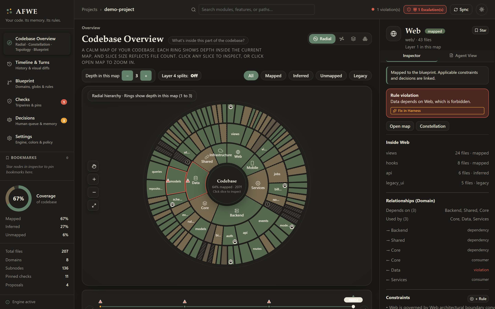
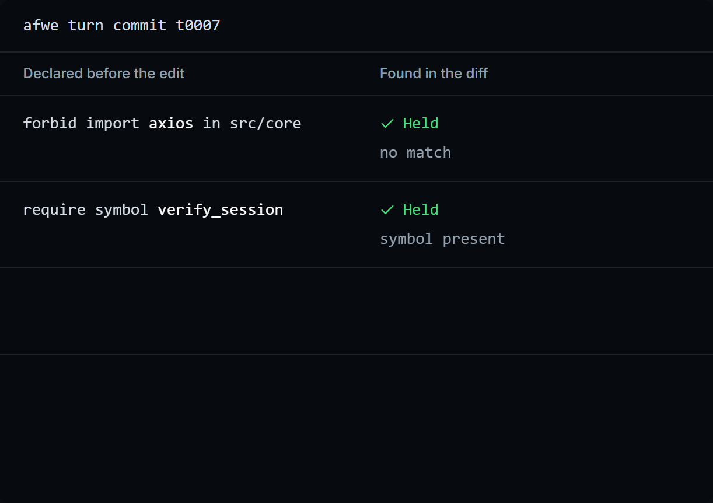
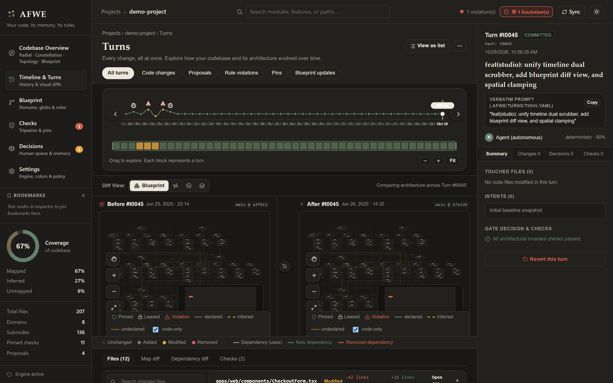
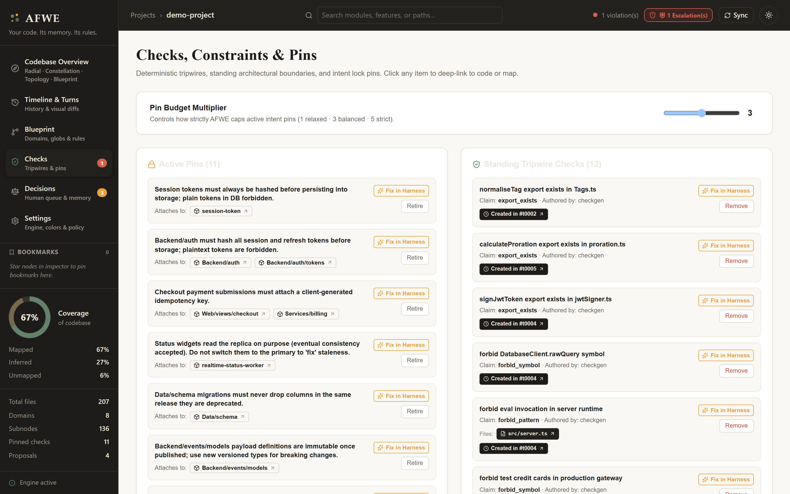
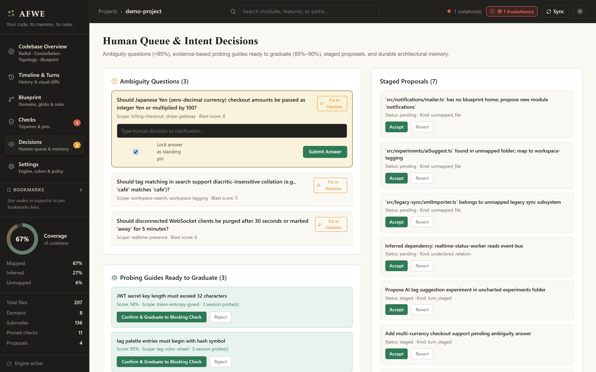

<p align="center">
  <svg viewBox="0 0 132 38" width="180" height="52" fill="none" stroke="currentColor" stroke-width="3" stroke-linecap="round" stroke-linejoin="round">
    <path d="M 4 23 L 15 3.5 L 26 23" />
    <line x1="40" y1="3.5" x2="62" y2="3.5" />
    <path d="M 40 3.5 V 23" />
    <line x1="40" y1="13.2" x2="58" y2="13.2" />
    <line x1="75" y1="2" x2="75" y2="23" />
    <line x1="83" y1="7.5" x2="83" y2="23" />
    <line x1="91" y1="2" x2="91" y2="23" />
    <line x1="104" y1="3.5" x2="126" y2="3.5" />
    <line x1="104" y1="13.2" x2="126" y2="13.2" />
    <line x1="104" y1="23" x2="126" y2="23" />
  </svg>
</p>

<h1 align="center">AFWE: Architecture-First Workspace Engine</h1>

<p align="center">
  <strong>YOUR CODE. ITS MEMORY. ITS RULES.</strong><br />
  <em>Double-entry bookkeeping for autonomous coding.</em>
</p>

<p align="center">
  <a href="https://github.com/StudioEaZY/afwe/releases"></a>
  <a href="https://www.rust-lang.org/"></a>
  <a href="https://tree-sitter.github.io/"></a>
  <a href="https://github.com/BLAKE3-team/BLAKE3"></a>
  <a href="#harness-integration-57-mcp-tools"></a>
  <a href="LICENSE"></a>
</p>

---

> **The folder is the product.** `.afwe/` is a human-readable, git-committed model of your codebase that sits between an autonomous AI agent harness (Claude Code, Cursor, Codex, Windsurf, OpenCode) and your repository. The Rust kernel, Tree-Sitter grammars, and BLAKE3 tripwires provide the deterministic verification engine: the engine is replaceable, but the architectural intent format is the permanent asset.

```text
Agent Harness (Claude / Cursor / Codex) ──MCP / CLI──▶ afwe engine ◀──reads/writes──▶ .afwe/ ◀──renders/edits── Studio
       │                                                      │
       └──────────────── edits source files ──────────────────┴──── AST & BLAKE3 Gating ────▶ Git History
```

AFWE is **not** an agent harness: it never owns your prompt loop and never calls external LLMs inside its validation kernel. It supplies the harness with scoped context before editing code, answers what constraints apply to touched files, and deterministically refuses changes that break architectural invariants.

---

## Why AFWE Exists

> *"Graph tools tell the agent what your code is. AFWE tells it what your code is supposed to be, and refuses changes that break that."*

Autonomous coding agents ship pull requests in seconds. But agents are stateless: they start every session fresh, carry no architectural memory, and do not understand the unwritten rules of your codebase.

Without architectural governance:
- **Agents quietly erase features** ("collateral feature loss") while refactoring adjacent code.
- **Agents bypass boundaries**, importing low-level databases into client UI or leaking server state.
- **Agents undo human decisions**, reopening intentional workarounds or breaking pinned contracts.

**AFWE establishes double-entry bookkeeping for codebases:**
1. **Implementation Entry**: Your source code records *what* was implemented.
2. **Intent Entry**: `.afwe/` records *why* and *what must not change* (blueprints, constraints, pins, memory).
3. **Turn Gating**: `afwe turn commit` deterministically checks both entries against each other before git touches disk.

### The Problem Spectrum

| Architectural Question | `grep` / Search | Code Graphs / GraphRAG | Linters & Tests | AFWE (`.afwe/`) |
| :--- | :---: | :---: | :---: | :---: |
| Where is `checkout()` defined? | Slow / Flat | Yes (AST graph) | No | **Yes** |
| What imports `Payments`? | Regex matches | Yes | Dependency graph | **Yes** |
| Is `Payments` **allowed** to import UI? | No | No | Custom rule files | **Yes (Boundary Constraint Gate)** |
| Is this unusual timeout a bug or intentional? | No | No | No | **Yes (Human Pin: `intentional`)** |
| Did an agent quietly erase an export or feature? | No | No | Only if unit tested | **Yes (Collateral Feature Loss Check)** |
| Why was this architectural decision made? | Git blame | No | PR comments (ephemeral) | **Yes (Scoped Memory Records)** |

---

## AFWE Studio: Real-Time Codebase Intelligence

The Studio (`afwe studio`) provides a live, interactive visualization of your codebase health, subsystem containment, and architectural drift:

<p align="center">
  
</p>

- **Mapping Coverage**: Real-time ratio of mapped, inferred, and unmapped code files across all subsystems.
- **Health Indicators**: Immediate notification of boundary violations, open human calibration questions, and active pins.
- **Drift Reconciliation**: Detects disagreement between disk files and the blueprint without guessing or inventing consensus.

---

## The Turn Protocol: Deterministic Verification Loop

Every agent prompt is wrapped in a **turn**. AFWE never calls a model; the harness does, and the AFWE Rust kernel wraps the interaction in three deterministic steps:

```text
01 Begin    afwe turn begin "<prompt>" --target <files>      → Scoped briefing pack: BLAKE3 baseline, active pins,
                                                               living intents, boundary rules, memory records.
02 Assume   afwe turn assume <turn> --file assumptions.json  → Tree-Sitter AST claims declared BEFORE code edits.
                                                               Pin conflicts trigger immediate REDO.
03 Commit   afwe turn commit <turn> --summary "..."          → Gated CAS commit: checks diffs against baseline,
                                                               verifies AST claims, blocks collateral loss.
```

### Deterministic Gating in Practice: The Rejection Ledger

When an agent violates an architectural invariant, AFWE blocks the commit. It outputs a structured audit ledger pinpointing exactly which claims held and which invariants broke:

<p align="center">
  
</p>

```text
afwe turn commit t0007: Rejected
────────────────────────────────────────────────────────────────────────────────────────
Declared before the edit                        Found in the diff
────────────────────────────────────────────────────────────────────────────────────────
forbid import axios in src/core                 Held (no match)
require symbol verify_session                   Held (symbol present)
pin-auth blocks edits to src/auth/session.rs    Broken (lines 42 to 61 changed)
no undeclared feature loss                      Broken (export_csv removed)
────────────────────────────────────────────────────────────────────────────────────────
Commit blocked. The agent redoes the turn, or you run afwe timeline restore.
```

- **Broken Pin**: Human locked `src/auth/session.rs` from changes. Edit refused.
- **Collateral Feature Loss**: `export_csv` disappeared without being declared in `removes`. Edit refused.
- **Zero Hallucination**: Gating runs locally using Tree-Sitter AST inspection and BLAKE3 cryptographic digests. No LLM can talk its way past the gate.

---

## What Lives in `.afwe/` (The Folder is the Product)

All architectural knowledge is committed directly into your repository inside `.afwe/`. It stays with your code, survives tool migrations, and avoids vendor lock-in:

```text
YOUR-REPO/.afwe/
├── afwe.yaml            # Manifest: project name, analyzer configuration, confidence policy
├── blueprint/
│   ├── blueprint.yaml   # Subsystems, components, purpose descriptions, and glob mappings
│   ├── relations.yaml   # Declared and inferred dependency edges with rationale
│   └── constraints.yaml # Boundary rules (must_not_depend, may_depend_only)
├── pins/                # Human-locked decisions and intentional bug markers
├── memory/              # Markdown knowledge with frontmatter scope
│   ├── decisions/       # Architectural decisions and rationale
│   └── constraints/     # Boundary explanations and enforcement notes
├── guardrails/          # Passive micro-context statements and active test checks
├── state/               # Drift records, proposals, and worktree leases
└── log/
    └── changes.jsonl    # Append-only audit ledger of every architectural change
```

| Component | Path | What it records |
| :--- | :--- | :--- |
| **Manifest** | `afwe.yaml` | Analyzer settings, confidence threshold (70%), and provenance tracking |
| **Blueprint** | `blueprint/blueprint.yaml` | Deterministic tree of nodes (`subsystem → component → file/symbol`) |
| **Relations** | `blueprint/relations.yaml` | Architectural edges (`depends_on`, `uses`) with declared vs inferred status |
| **Constraints** | `blueprint/constraints.yaml` | Boundary rules enforced at pre-commit (`must_not_depend`, `may_depend_only`) |
| **Pins** | `pins/*.yaml` | Human decisions locked from changes under a calibrated budget slider |
| **Memory** | `memory/**/*.md` | Knowledge records scoped to nodes, file globs, or AST symbols |
| **Guardrails** | `guardrails/**/*.yaml` | Active checks (`forbid_import`, `require_pattern`, `command`) |
| **Audit Log** | `log/changes.jsonl` | Append-only event log with author origin (`human` or `llm:<name>`) |

---

## Studio Interface & Exploration

The AFWE Studio provides specialized visual workspaces for inspecting and refining your codebase architecture:

### 1. Interactive Architecture Blueprint
Drag-and-drop hierarchy navigation, boundary constraint enforcement, and relationship mapping:
<p align="center">
  
</p>

### 2. Causal Timeline & Turn Scrubbing
Inspect every prompt turn with its confidence score, AST claims, diff viewer, and 3-way feature restore:
<p align="center">
  
</p>

### 3. Active Checks & Pin Budgets
Review tripwires, AST symbol requirements, and human pins across your codebase:
<p align="center">
  
</p>

### 4. Memory & Architectural Decisions
Explore scoped decision records, exceptions, and human review queues:
<p align="center">
  
</p>

---

## Harness Integration: 57 MCP Tools

AFWE runs a Model Context Protocol (MCP) server over standard I/O via `afwe mcp`. It exposes 57 structured tools natively compatible with **Claude Code**, **Cursor**, **Codex**, **Windsurf**, and **OpenCode**:

| Tool Category | Key MCP Tools | Purpose |
| :--- | :--- | :--- |
| **Turn Lifecycle** | `afwe_turn_begin`, `afwe_turn_assume`, `afwe_turn_commit`, `afwe_turn_redo`, `afwe_turn_abandon` | Execute the 3-step intent and verification loop |
| **Context & Retrieval** | `afwe_context`, `afwe_search`, `afwe_status` | Retrieve scoped pins, living intents, and memory |
| **AST Verification** | `afwe_verify`, `afwe_gate`, `afwe_check_run` | Run active guardrails, forbidden imports, and CI gate |
| **Blueprint & Rules** | `afwe_blueprint_edit`, `afwe_blueprint_constrain`, `afwe_blueprint_add` | Declare subsystems, relations, and boundary constraints |
| **Memory & Decisions** | `afwe_memory_add`, `afwe_memory_search` | Store scoped architectural decisions and exceptions |
| **Pins & Budgets** | `afwe_pin_add`, `afwe_pin_retire`, `afwe_pin_budget` | Lock critical files and intentional bugs from edits |
| **Causal Timeline** | `afwe_timeline_list`, `afwe_timeline_restore`, `afwe_timeline_diff` | Inspect turn history and restore erased features |
| **Concurrency Leases** | `afwe_lease_acquire`, `afwe_lease_release`, `afwe_lease_list` | Prevent multi-agent race conditions across worktrees |

### Claude Desktop & Agent Configuration
Add AFWE to your `claude_desktop_config.json` or `.cursor/mcp.json`:

```json
{
  "mcpServers": {
    "afwe": {
      "command": "afwe",
      "args": ["mcp"]
    }
  }
}
```

---

## Quickstart (Zero to Protected in 60 Seconds)

### 1. Build and Install
Requires Rust 1.75 or higher:
```bash
cargo install --path crates/afwe-cli
```

### 2. Initialize Your Repository
```bash
cd your-project
afwe init --name "My Service" --agents-md
```
This generates `.afwe/` and appends the non-negotiable turn contract to `AGENTS.md` (or `CLAUDE.md`).

### 3. Declare Architecture & Boundary Rules
```bash
# Add architectural components
afwe blueprint add Payments --purpose "Charging users and managing invoices" --files "src/payments/**"
afwe blueprint add Identity --purpose "User accounts and authentication" --files "src/identity/**"

# Declare relations and boundary constraints
afwe blueprint relate Payments Identity --why "Payments requires user authentication"
afwe blueprint constrain Payments --must-not-depend UI --why "Runs headless in background workers"

# Record a human architectural decision
afwe memory add decision "Sessions expire after 24 hours" --applies-to Identity --tags auth
```

### 4. Run the Turn Protocol
```bash
# Step 1: Begin turn and receive scoped briefing
afwe turn begin "Add Stripe webhook verification" --target src/payments/*

# Step 2: Declare claims before modifying code
afwe turn assume t0001 --file assumptions.json

# Step 3: Gated commit with receipt trailer
afwe turn commit t0001 --summary "Added Stripe webhook verification"
```

### 5. Launch the Studio
```bash
afwe studio
```
Opens the interactive visual workspace at `http://localhost:4242` (or uses the Tauri desktop shell).

---

## Repository Layout

```text
crates/afwe-core       Engine kernel: schema, AST analysis, Tree-Sitter grammars,
                       BLAKE3 tripwires, CAS gate, turn protocol, timeline, onboarding
crates/afwe-cli        CLI binary: command parser, MCP server (stdio), embedded Studio host
apps/studio            React + React Flow visual workspace (Vite) and Tauri desktop shell
examples/demo-project  Populated .afwe/ environment with active pins, drift, and rules
docs/                  Master technical specifications, tutorials, and walkthroughs
scripts/               Automation scripts: build, test, demo tours, screenshot capture
```

---

## Tests & Verification

```bash
# Run kernel unit, integration, and turn-protocol tests
cargo test

# Run the end-to-end turn flow tour on a throw-away git copy
./scripts/demo.sh
```

The turn-protocol test suite verifies the complete loop against live Git plumbing:
- Committed turns with AST claims that graduate into standing tripwires.
- REDO triggers on boundary constraint violations with zero files committed.
- Collateral feature loss interception and 3-way merge restoration.
- Human block pins refusing unauthorized file edits.
- Whole-project CI gate enforcement via `afwe gate`.

---

## Documentation & Guides

- **[Developer Tutorial (Zero to Mastery)](docs/TUTORIAL.md)**: Interactive guide covering onboarding, turn protocol, pin budgets, and 3-way timeline restoration.
- **[Real-World Case Study](docs/WALKTHROUGH.md)**: Step-by-step case study showing how AFWE decomposes complex qualitative prompts into Tree-Sitter AST claims.
- **[Format Specification](docs/SPEC.md)**: Technical format specification of the `.afwe/` product folder.
- **[Harness Integration Guide](docs/INTEGRATION.md)**: Complete configuration guides for Claude Code, Cursor, Codex, and custom CI pipelines.

---

## License

AFWE is licensed under the [MIT License](LICENSE). Built for developers and autonomous agents who believe architectural intent should never be lost.
